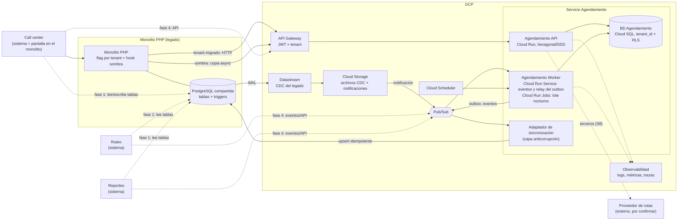

# Salida del módulo de Agendamiento del monolito — Documento de diseño

**Autor:** Andres Maldonado · **Rol:** Líder Técnico · **Fecha:** 2026-10-27 · **Estado:** borrador

**Propuesta en una frase:** extraer Agendamiento con *Strangler Fig* en modo sombra, con corte progresivo **por tenant**, un **único escritor por tenant** y sincronización hacia las tablas del legado, de modo que call center, ruteo y reportes no cambien su fuente de lectura en la primera fase.

## 0. Supuestos

| # | Supuesto |
|---|---|
| S1 | 40.000 guías/día ≈ 0,5 req/s promedio; el lote nocturno concentra ~80 % en ~2 h (≈ 4–5 req/s). Carga baja: **un servicio bien hecho, no una malla de microservicios**. |
| S2 | PostgreSQL legado ≥ 10 con replicación lógica (`wal_level=logical`) o réplica de lectura; se valida en la semana 1. |
| S3 | Guías y cobertura (días por cliente y ciudad) las mantienen otros módulos; Agendamiento solo asigna fecha y estado. |
| S4 | El lote debe terminar antes de las 05:00 porque ruteo lo consume (hora por confirmar). |
| S5, S6 | Cambios mínimos y con *flag* en el monolito (un hook y el trigger), sin refactors. «Día hábil» = lunes a viernes sin festivos del país. |
| S7 | Equipo al 100 %, con 30 % de descuento por soporte del legado, ceremonias y ausencias. Sprints de 2 semanas. |
| S8 | Los efectos secundarios (terceros como el proveedor de rutas, notificaciones) no se replican en la sombra. |
| S9 | Motivo: llegar a la nube con servicios gestionados de GCP, saliendo del *co-location* u on premise donde se asume que corre hoy el monolito (por confirmar). Clientes financieros: más rendimiento y escalabilidad sin ceder en seguridad. La línea base (tiempos, costo, incidentes, soporte) se mide en F0. |
| S10 | La pantalla del call center es parte del monolito; el call center (sistema), ruteo y reportes son tres sistemas que leen o escriben las tablas (H1.4 confirma cuáles escriben). En un tenant migrado, toda escritura pasa por el API. |

## 1. Arquitectura objetivo (C4 nivel 2)

- **Agendamiento API** (Cloud Run, TypeScript/NestJS, hexagonal + DDD): `AgendarGuia` y consulta de citas. El monolito llama con una cuenta de servicio y el tenant va en un claim firmado que valida el Gateway. Workers y adaptador, sin JWT, reciben el tenant en el mensaje o en la cola del lote y lo fijan con `SET LOCAL` por transacción (pooler en modo transacción).
- **Worker:** un Cloud Run Service siempre activo para los consumidores CDC y el relay del *outbox* (el lag < 5 s lo exige), y Cloud Run Jobs solo para el lote nocturno por tenant.
- **BD Agendamiento** (Cloud SQL Postgres): agenda, proyecciones de guías y cobertura, *outbox*, festivos. Aislamiento con `tenant_id` y RLS.
- **Adaptador de sincronización:** traduce `GuiaAgendada` a escrituras idempotentes en las tablas legado; es el **único** componente que conoce su esquema.
- **Datastream (CDC):** alimenta las proyecciones de solo lectura (guías, cobertura). No publica en Pub/Sub: escribe archivos en Cloud Storage y sus notificaciones llegan a Pub/Sub. Es más lento que el *outbox*, así que los 5 s aplican a la sincronización hacia el legado, no a las proyecciones.
- **Monolito, call center, ruteo y reportes:** el monolito consulta el *flag* por tenant y, si está migrado, llama al API en lugar de usar el trigger. En la fase 1 los tres sistemas siguen usando las tablas legado (ya sincronizadas) y el call center escribe vía API en los tenants migrados; en la fase 4 pasan a eventos o API.

## 2. Estrategia de migración

**Principios:** (1) seguridad antes que velocidad; (2) un solo escritor por tenant; (3) todo reversible con un *flag*; (4) lo más riesgoso va al final.

| Fase | Qué se hace | Criterio de salida | Duración |
|---|---|---|---|
| **F0 Red de seguridad** | Inventario de triggers, funciones, tablas, **efectos laterales de cada trigger**, consumidores y escritores reales; *characterization tests* (golden master) con datos anonimizados; línea base del motivo (S9) | Reglas documentadas; cada efecto lateral con dueño; golden master en CI | Sem. 1–2 |
| **F1 Sombra** | El servicio calcula en paralelo las agendas por demanda, **sin escribir** en el legado; un comparador registra discrepancias | ≥ 99,9 % de coincidencia (tras normalizar causas legítimas) durante 10 días hábiles en ≥ 2 tenants, con la sombra activa desde la semana 5; si no se cumple, F2 no arranca | Sem. 3–6 |
| **F2 Corte por demanda** | Canary con 1–2 tenants pequeños y luego olas (5, 10, resto), ordenadas por una matriz (volumen, complejidad de cobertura, riesgo contractual, disposición a ser piloto) definida en F0; la sombra usa tenants representativos y el canary, de bajo riesgo. El servicio es el único escritor y sincroniza hacia el legado; el trigger se desactiva por tenant | 4 semanas del canary sin *drift* ni incidentes; aislamiento entre tenants y auditoría verificados | Sem. 7–10 |
| **F3 Lote nocturno** | Primero sombra de la corrida completa; luego corte por olas de tenants. Ruteo adopta la señal de lote finalizado. El lote legado queda de respaldo ≥ 4 semanas | Lote termina antes de las 05:00 en todas las olas | Sem. 11–14 |
| **F4 Lectores y retiro** | Ruteo, reportes y call center pasan a eventos/API; se retiran sincronización, triggers y tablas (*expand/contract*) | Cero lecturas directas a las tablas | Sem. 15+ |

**Por qué este orden:** lo *por demanda* tiene poco volumen y radio de impacto pequeño, y da retroalimentación rápida. El lote (40.000 guías, sin segunda oportunidad en la ventana) va al final: ejecuta el mismo caso de uso, así que su corrección se valida antes con lo por demanda, y volumen y ventana se prueban antes del corte con la prueba de capacidad (H2.4). Los lectores son el acoplamiento menos conocido; la sincronización los mantiene vivos, así que pueden esperar.

**Convivencia:** el controlador del monolito (único punto de entrada de la pantalla) enruta con el flag `agendamiento_en_servicio` por tenant. La **sombra** es un hook asíncrono con *timeout* corto: si falla, el flujo real no se entera. El comparador contrasta fecha y estado contra un *snapshot* con marca de tiempo, para no confundir un cambio legítimo de cobertura o festivo con una discrepancia.

**Alternativas descartadas:** la *reescritura* o *big bang* (la lógica oculta en triggers, riesgo 1, no está caracterizada: sin pruebas no hay equivalencia demostrable); la *ventana de mantenimiento* (exige una parada aceptada por los 30 clientes y por el lote de las 05:00, sin vuelta atrás rápida); *solo aislar en el monolito* o *lift and shift* (no llevan el módulo a servicios gestionados ni dan escalado independiente por tenant, S9: cambian el hosting, no el acoplamiento); el *paralelo completo* (es la sombra: lo por demanda en F1 y el lote en F3); la BD compartida sin CDC (ADR-001, opción A).

**Pausa o aborto** (lo decide un comité con sponsor de negocio; umbrales propuestos, por validar): (1) la coincidencia en sombra no llega a 99,9 % tras 4 semanas más de triaje; (2) un incidente grave atribuible al servicio en el canary, o *drift* recurrente sin explicar; (3) la cota alta de F1 se excede más de 25 %. Si se aborta, queda lo de F0. F2–F4 se estiman al cerrar F1.

## 3. Datos

| Tema | Decisión |
|---|---|
| **Propiedad** | El servicio es dueño de `agenda` (estado y fecha). Guías y cobertura siguen siendo del legado y llegan por CDC como proyecciones de solo lectura. |
| **Un escritor por tenant** | No migrado: escribe el legado. Migrado: solo el servicio; la reagenda manual del call center también pasa por el API. |
| **Hacia el legado** | *Outbox* transaccional → Pub/Sub → adaptador, con *upsert* idempotente por `guia_id` + versión. La versión la asigna el agregado, monótona por guía, con *ordering key* por `guia_id`; el adaptador guarda la última versión aplicada en su propia tabla (no en el legado) y descarta las menores. Ruteo y reportes siguen leyendo igual (ruteo adopta la señal de lote en F3). Lag objetivo: < 5 s p95. |
| **Triggers** | (1) Inventariar los efectos laterales de cada trigger (otras tablas, auditoría, estados que lee ruteo), asignar dueño (dominio, adaptador o se mantiene) y caracterizar con golden master las tablas afectadas, no solo fecha y estado. (2) Reimplementar como reglas de dominio con pruebas. (3) Desactivar por tenant con un flag dentro del trigger (cambio mínimo, apagado por defecto). (4) Eliminar en F4. El adaptador usa un rol dedicado que el trigger **ignora**. |
| **Consistencia** | Eventual con ventana acotada. `AgendarGuia` lleva los datos de la guía que ya tiene el monolito (no depende del CDC); la cobertura puede ir desactualizada unos minutos y el resultado registra la versión usada. Reconciliación incremental por ventana horaria y tenant, con detalle por guía, más una completa nocturna (conteos + hash por estado/fecha), con alerta; la reparación desde el servicio es manual en las primeras olas y automática solo tras ganar confianza. |
| **Cambios de esquema** | Siempre *expand/contract*: nunca se renombra ni se borra en el mismo despliegue. |

## 4. Multitenancy

**Modelo elegido: pool.** BD y esquema compartidos, `tenant_id` en todas las tablas (parte de las claves únicas) y **Row-Level Security** con `FORCE ROW LEVEL SECURITY`. Cada transacción fija `SET LOCAL app.tenant_id`; el rol de la aplicación no tiene `BYPASSRLS`.

| Opción | Veredicto |
|---|---|
| **Pool + RLS** | **Elegida.** 30 tenants, carga baja y homogénea, mismas reglas (solo cambian los datos de cobertura). Una migración, un pool de conexiones, menor costo; el legado ya es compartido. |
| Esquema o BD por tenant | Descartadas: ×30 migraciones y pools (esquema) o sobrecosto operativo (BD) sin necesidad hoy. |

**Riesgos:** fuga entre tenants (RLS + pruebas de aislamiento en CI) y vecino ruidoso (cuota por tenant, lote con colas por tenant y concurrencia limitada). **Vía de escape:** un catálogo `tenant → conexión` mueve a un cliente grande o regulado a su propia BD sin cambiar el dominio.

## 5. Calidad y operación

**Pruebas (el legado no tiene):** (1) **golden master:** las funciones SQL se ejecutan sobre fixtures reales anonimizados y se congelan sus salidas como fuente de verdad del comportamiento actual. (2) **Unitarias de dominio** (≥ 90 %), **integración** con Testcontainers y **aislamiento multitenant**. (3) **Contrato** (Pact) con call center, ruteo y reportes. (4) **Sombra en producción:** la prueba definitiva con datos reales; el QA es dueño del dataset dorado y del triaje.

**Seguridad (clientes financieros):** cifrado en tránsito y reposo (llaves gestionadas por el cliente si lo exige), secretos en Secret Manager, mínimo privilegio por rol y cuenta de servicio, auditoría de accesos (pgaudit) y datos anonimizados en sombra y pruebas. Antes de cada corte se verifican aislamiento entre tenants, auditoría y rol sin `BYPASSRLS`.

**Observabilidad:** OpenTelemetry y logs estructurados con `tenant_id` y **sin datos personales**. Métricas RED y de negocio (guías agendadas/min, % `SIN_COBERTURA`, discrepancia en sombra, lag, *drift*). SLO: 99,9 % de disponibilidad por demanda (≈ 43 min/mes) y lote terminado antes de las 05:00. SLI por tenant: peticiones exitosas bajo un umbral por definir y frescura del lote. Alertas por consumo del presupuesto de error, lag y drift. Guardia rotativa y runbooks listos antes del primer tenant real (F2).

**Despliegue:** CI/CD por commit, Terraform, Cloud Run con revisiones y tráfico gradual (5 → 50 → 100 %), migraciones *expand/contract* y flags por tenant en `tenant_config`.

**Rollback en tres niveles:** (1) **por tenant (minutos):** pausar escrituras, drenar el *outbox* y apagar el flag; el legado ya tiene los datos, así que no se pierde nada. (2) **Por versión:** revisión anterior de Cloud Run. (3) **Datos:** migraciones solo hacia adelante y *point-in-time recovery* en Cloud SQL.

## 6. Riesgos principales

| # | Riesgo | Prob./Impacto | Mitigación |
|---|---|---|---|
| 1 | **Lógica oculta en triggers/funciones** que nadie documentó | Alta / Alto | Inventario, golden master, sombra con triaje de discrepancias antes de cualquier corte |
| 2 | **Divergencia de datos** entre legado y servicio (dos escritores, lag de CDC) | Media / Alto | Un escritor por tenant, *outbox* idempotente, reconciliación incremental con alerta, *kill-switch* por tenant |
| 3 | **Consumidores ocultos** de las tablas (más allá de los tres conocidos) | Media / Alto | Auditoría de accesos (`pg_stat_statements`, logs), pruebas de contrato, tablas compatibles hasta F4 |
| 4 | **Operación 24/7 y ventana del lote**: 40.000 guías sin segunda oportunidad | Media / Muy alto | Lote al final, por olas, idempotente y reanudable; prueba de capacidad a 3× (H2.4); runbook; lote legado de respaldo ≥ 4 semanas. Punto de decisión (propuesto, 03:30): si el avance proyectado no llega a las 05:00, la guardia lanza el lote legado para los tenants pendientes (rollback por tenant, sin doble escritura) |
| 5 | **Capacidad y conocimiento del equipo**: 5 personas, legado sin documentación, además se da soporte | Alta / Medio | Alcance acotado por fase, *pairing* senior + semi senior, colchón real de ~4 días sobre la cota alta (el 30 % ya está descontado, S7), decisiones en ADR |

## 7. Plan de trabajo — Fase 1: cimientos y sombra (F0 + F1, ~6 semanas)

Estimaciones en **días-persona** (incluyen pruebas y revisión). Capacidad: 5 × 30 = 150 brutos, ~105 netos tras el 30 % de descuento, ya descontado: el colchón real es 105 − 101 = ~4 días sobre la cota alta.

| Épica / Historia | Rango | Quién |
|---|---|---|
| **E1 Red de seguridad del legado** | **11–19** | |
| H1.1 Inventario de triggers, funciones, tablas y efectos laterales, con dueño | 2–4 | Sr1 |
| H1.2 Extraer y documentar reglas de agendamiento | 3–5 | Sr1 + QA |
| H1.3 Dataset dorado anonimizado + arnés de characterization tests | 4–7 | QA + SSr2 |
| H1.4 Detectar consumidores y escritores reales (`pg_stat_statements`, pgaudit) | 2–3 | SSr2 |
| **E2 Plataforma del servicio** | **15–24** | |
| H2.1 Repo hexagonal, CI/CD e IaC (Cloud Run, Cloud SQL) | 5–8 | Sr2 |
| H2.2 Observabilidad base | 3–5 | SSr2 |
| H2.3 Multitenancy: contexto de tenant, RLS y pruebas de aislamiento | 4–6 | Sr2 + QA |
| H2.4 Prueba de capacidad a 3× del lote en staging (120.000 guías sintéticas) | 3–5 | Sr2 + QA |
| **E3 Dominio de Agendamiento** | **12–19** | |
| H3.1 Caso de uso «Agendar guía» (reglas y puertos) | 5–8 | SSr1 (+ Sr2 en revisión) |
| H3.2 Adaptadores Postgres y calendario de festivos | 4–6 | SSr1 |
| H3.3 `POST /v1/agendamientos` + autenticación | 3–5 | SSr1 |
| **E4 Datos y sincronización** | **9–15** | |
| H4.1 CDC legado → proyecciones (guías y cobertura) | 6–10 | Sr1 |
| H4.2 *Spike* del outbox y adaptador (la implementación va a F2) | 3–5 | Sr2 |
| **E5 Modo sombra** | **14–24** | |
| H5.1 Hook en el legado: copia async con flag y timeout | 3–5 | SSr2 |
| H5.2 Comparador, tabla de discrepancias y dashboard | 4–6 | SSr2 + Sr2 |
| H5.3 Triaje de discrepancias y ajuste de reglas | 5–10 | QA + Sr1 |
| H5.4 Criterios de corte y runbook de rollback | 2–3 | Líder + QA |
| **Total** | **61–101** | |

**Reparto:** columna *Quién*. SSr2 acompaña a Sr1 en el inventario (el conocimiento del legado no puede depender de una persona); el Líder lleva el ADR, los stakeholders, la revisión de PR críticos y el comité de corte.

**Hitos:** **Sprint 1:** inventario, dataset dorado y CI/CD en staging (red de seguridad del legado aunque el proyecto se detuviera). **Sprint 2:** dominio y API en staging, CDC alimentando las proyecciones y hook de sombra probado; se enciende para ≥ 2 tenants el primer día del Sprint 3. **Sprint 3:** sombra activa 10 días hábiles con ≥ 2 tenants, triaje continuo y dashboard; al cierre, informe de triaje y criterios de corte. Si H5.3 se desliza, el criterio se mide en la semana 7 y F2 arranca después.

**Supuestos de la estimación:** replicación lógica concedida en la semana 1 (S2); un semi senior con soltura en PHP; sin crecimiento de alcance en el legado. La cota alta ocupa ~96 % de la capacidad neta; si se acerca, H2.4, H5.3 y H4.2 pasan al siguiente sprint (H2.4 solo debe estar lista antes del corte del lote, en F3).

## 8. ADR-001 — Fuente de verdad y sincronización durante la convivencia

**Estado:** propuesto · **Fecha:** 2026-10-27

**Contexto.** Durante la migración, call center, ruteo y reportes siguen leyendo las tablas legado, y el call center también escribe; el legado tiene triggers sobre ellas. Hay que definir la fuente de verdad sin detener la operación.

**Opciones.**

| Opción | A favor | En contra |
|---|---|---|
| **A. BD compartida temporal:** el servicio escribe directo en las tablas legado | Sin problema de consistencia; la más rápida | Los **triggers se disparan con las escrituras del servicio**; el servicio no evoluciona su esquema; sin aislamiento por tenant; rollback enredado con el legado. Traslada el problema |
| **B. Dual-write:** el servicio escribe en su BD y en la del legado | Aparentemente simple | Sin transacción distribuida; si una escritura falla, divergencia silenciosa; difícil de reconciliar |
| **C. Servicio dueño por tenant + outbox/CDC hacia el legado** | Un solo escritor por tenant; esquema propio; el legado sigue actualizado (rollback sin pérdida); lectores sin cambios | Consistencia eventual (< 5 s); más piezas (CDC, outbox, adaptador, reconciliación) |

**Decisión.** Opción **C**: el servicio es el único escritor de los tenants migrados. Un *outbox* transaccional publica eventos que un adaptador (capa anticorrupción) aplica de forma idempotente en las tablas legado. El CDC alimenta las proyecciones del servicio. Una reconciliación incremental, más una completa nocturna, detecta el *drift*.

**Consecuencias.**
- (+) Rollback por tenant en minutos y sin pérdida de datos.
- (+) El esquema del servicio evoluciona sin coordinar con el legado.
- (−) Consistencia eventual: ruteo debe respetar la señal `LoteAgendamientoFinalizado` (no hace falta en F2; en F3 el adaptador escribe la marca en una tabla de control al drenar el *outbox* y ruteo la consulta). El SLO del lote se mide con el *outbox* drenado.
- (−) Más componentes que operar; se compensa con alertas de lag y drift.

**Cuándo revisarla.** Si el lag p95 supera los 5 s de forma sostenida, o si la reconciliación detecta *drift* recurrente que no se explica por el lag, se reevalúa (por ejemplo, adelantando la migración de los lectores a F2).
