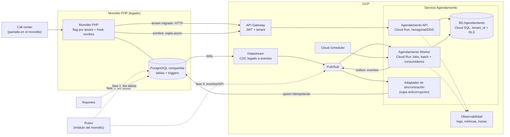

# Salida del módulo de Agendamiento del monolito — Documento de diseño

**Autor:** [Tu nombre] · **Rol:** Líder Técnico · **Fecha:** 2026-10-27 · **Estado:** borrador

**Propuesta en una frase:** extraer Agendamiento con *Strangler Fig* en modo sombra, con corte progresivo **por tenant**, un **único escritor por tenant** y sincronización hacia las tablas del legado, de modo que call center, ruteo y reportes no cambien en la primera fase.

## 0. Supuestos

| # | Supuesto |
|---|---|
| S1 | 40.000 guías/día ≈ 0,5 req/s promedio; el lote nocturno concentra ~80 % en ~2 h (≈ 4–5 req/s). Es carga baja: **un servicio bien hecho, no una malla de microservicios**. |
| S2 | El PostgreSQL legado es ≥ 10 y permite replicación lógica (`wal_level=logical`) o una réplica de lectura. Se valida en la semana 1. |
| S3 | Las guías y la cobertura (días por cliente y ciudad) las mantienen otros módulos; Agendamiento solo asigna fecha y estado. |
| S4 | El lote nocturno debe terminar antes de las 05:00 porque ruteo lo consume (hora por confirmar). |
| S5 | Se aceptan cambios mínimos y con *flag* en el monolito (un hook y el trigger), no refactors. |
| S6 | «Día hábil» = lunes a viernes sin festivos del país (calendario por país). |
| S7 | El equipo está dedicado al 100 %, con 30 % de descuento por soporte del legado, ceremonias y ausencias. Sprints de 2 semanas. |
| S8 | Los efectos secundarios (llamadas a terceros, notificaciones) no se replican en modo sombra. |

## 1. Arquitectura objetivo (C4 nivel 2)

- **Agendamiento API** (Cloud Run, TypeScript/NestJS, hexagonal + DDD): comando `AgendarGuia` y consulta de citas. El tenant sale del claim del JWT, nunca del cuerpo.
- **Agendamiento Worker** (Cloud Run Jobs): lote nocturno por tenant, consumidores de eventos CDC y relay del *outbox*.
- **BD Agendamiento** (Cloud SQL Postgres): agenda, proyecciones de guías y cobertura, *outbox*, calendario de festivos. Aislamiento con `tenant_id` y RLS.
- **Adaptador de sincronización:** traduce `GuiaAgendada` a escrituras idempotentes en las tablas del legado. Es el **único** componente que conoce el esquema legado.
- **Datastream (CDC):** alimenta las proyecciones de solo lectura (guías, cobertura) sin tocar el monolito.
- **Monolito:** consulta un *flag* por tenant. Si el tenant está migrado, la pantalla del call center llama al API en lugar de usar el trigger.
- **Ruteo y reportes:** en la fase 1 siguen leyendo las tablas legado (ya sincronizadas); en la fase 4 pasan a eventos o API.

## 2. Estrategia de migración

**Principios:** (1) seguridad antes que velocidad; (2) un solo escritor por tenant; (3) todo reversible con un *flag*; (4) lo más riesgoso va al final.

| Fase | Qué se hace | Criterio de salida | Duración |
|---|---|---|---|
| **F0 Red de seguridad** | Inventario de triggers, funciones, tablas y consumidores reales; *characterization tests* (golden master) con datos anonimizados | Reglas documentadas; el golden master corre en CI | Sem. 1–2 |
| **F1 Sombra** | El servicio calcula en paralelo las agendas por demanda, **sin escribir** en el legado; un comparador registra discrepancias | ≥ 99,9 % de coincidencia (tras normalizar causas legítimas) durante 10 días hábiles en ≥ 2 tenants | Sem. 3–6 |
| **F2 Corte por demanda** | Canary con 1–2 tenants pequeños, luego olas (5, 10, resto). El servicio es el único escritor y sincroniza hacia el legado; el trigger se desactiva por tenant | 4 semanas del canary sin *drift* ni incidentes | Sem. 7–10 |
| **F3 Lote nocturno** | Primero sombra de la corrida completa; después corte por olas de tenants. El lote legado queda como respaldo ≥ 4 semanas | Lote termina antes de las 05:00 en todas las olas | Sem. 11–14 |
| **F4 Lectores y retiro** | Ruteo, reportes y call center pasan a eventos/API; se retiran sincronización, triggers y tablas (*expand/contract*) | Cero lecturas directas a las tablas | Sem. 15+ |

**Por qué este orden:** lo *por demanda* tiene poco volumen y un radio de impacto pequeño, y da retroalimentación rápida. El lote nocturno (40.000 guías, sin segunda oportunidad dentro de la ventana) depende de todo lo anterior, así que va al final. Los lectores son el acoplamiento menos conocido; mientras la sincronización los mantenga vivos, pueden esperar.

**Convivencia:** el enrutamiento vive en el controlador del monolito (único punto de entrada de la pantalla), con el flag `agendamiento_en_servicio` por tenant. La **sombra** es un hook asíncrono con *timeout* corto: si falla, el flujo real no se entera. El comparador contrasta fecha y estado contra un *snapshot* con marca de tiempo, para no confundir un cambio legítimo de cobertura o festivo con una discrepancia.

## 3. Datos

| Tema | Decisión |
|---|---|
| **Propiedad** | El servicio es dueño de `agenda` (estado y fecha de cita). Guías y cobertura siguen siendo del legado y llegan por CDC como proyecciones de solo lectura. |
| **Un escritor por tenant** | Tenant no migrado: escribe el legado. Tenant migrado: solo el servicio. La reagenda manual del call center también pasa por el API. |
| **Hacia el legado** | *Outbox* transaccional en la BD del servicio → Pub/Sub → adaptador, con *upsert* idempotente por `guia_id` + versión. Ruteo y reportes no cambian. Lag objetivo: < 5 s p95. |
| **Triggers** | (1) Caracterizar con golden master. (2) Reimplementar como reglas de dominio con pruebas. (3) Desactivar por tenant con el flag dentro del trigger (cambio mínimo, por defecto apagado). (4) Eliminar en F4. El adaptador usa un rol dedicado y el trigger **ignora sus escrituras**. |
| **Consistencia** | Eventual con ventana acotada. Versión monótona por guía. Reconciliación nocturna por tenant (conteos + hash por estado/fecha) con alerta; para un tenant migrado se repara desde el servicio. |
| **Cambios de esquema** | Siempre *expand/contract*: nunca se renombra ni se borra en el mismo despliegue. |

## 4. Multitenancy

**Modelo elegido: pool.** BD y esquema compartidos, `tenant_id` en todas las tablas (parte de las claves únicas) y **Row-Level Security** con `FORCE ROW LEVEL SECURITY`. Cada transacción fija `SET LOCAL app.tenant_id`. El rol de la aplicación no tiene `BYPASSRLS`.

| Opción | Veredicto |
|---|---|
| **Pool + RLS** | **Elegida.** 30 tenants, carga baja y homogénea, mismas reglas (solo cambian los datos de cobertura). Una sola migración, un solo pool de conexiones, menor costo. Además el legado ya es compartido. |
| Esquema por tenant | Descartada: ×30 migraciones y pools para poco aislamiento adicional. |
| BD por tenant | Descartada: sobrecosto operativo sin necesidad hoy. |

**Riesgos del modelo y mitigación:** fuga entre tenants (RLS + pruebas automáticas de aislamiento en CI); vecino ruidoso (cuota por tenant y lote con colas por tenant y concurrencia limitada). **Vía de escape:** un catálogo `tenant → conexión` permite mover a un cliente grande o con exigencia contractual/regulatoria a su propia BD sin cambiar el código de dominio.

## 5. Calidad y operación

**Pruebas (el legado no tiene):**
1. **Characterization tests / golden master:** las funciones SQL se ejecutan sobre fixtures reales anonimizados y se congelan sus salidas; es la fuente de verdad del comportamiento actual.
2. **Unitarias de dominio** (≥ 90 %), **integración** con Testcontainers y **aislamiento multitenant**.
3. **Contrato** (Pact) con call center, ruteo y reportes.
4. **Sombra en producción:** la prueba definitiva con datos reales. El QA es dueño del dataset dorado y del triaje de discrepancias.

**Observabilidad:** OpenTelemetry (trazas), logs estructurados con `tenant_id` y **sin datos personales**. Métricas técnicas (RED) y de negocio: guías agendadas/min, % `SIN_COBERTURA`, tasa de discrepancia en sombra, lag de sincronización, *drift* de reconciliación. SLO: 99,9 % de disponibilidad por demanda; lote terminado antes de las 05:00. Alertas sobre lag, drift y el SLO del lote.

**Despliegue:** CI/CD con *pipeline* por commit, infraestructura como código (Terraform), Cloud Run con revisiones y tráfico gradual (5 → 50 → 100 %). Migraciones *expand/contract*. Flags por tenant en `tenant_config`.

**Rollback en tres niveles:**
1. **Por tenant (minutos):** pausar escrituras, drenar el *outbox* y apagar el flag; el legado ya tiene los datos porque la sincronización los mantuvo, así que **no se pierde nada**.
2. **Por versión:** volver a la revisión anterior de Cloud Run.
3. **Datos:** migraciones solo hacia adelante y *point-in-time recovery* en Cloud SQL.

## 6. Riesgos principales

| # | Riesgo | Prob./Impacto | Mitigación |
|---|---|---|---|
| 1 | **Lógica oculta en triggers/funciones** que nadie documentó | Alta / Alto | Inventario, golden master, sombra con triaje de discrepancias antes de cualquier corte |
| 2 | **Divergencia de datos** entre legado y servicio (dos escritores, lag de CDC) | Media / Alto | Un escritor por tenant, *outbox* idempotente, reconciliación nocturna con alerta, *kill-switch* por tenant |
| 3 | **Consumidores ocultos** de las tablas (más allá de los tres conocidos) | Media / Alto | Auditoría de accesos (`pg_stat_statements`, logs), pruebas de contrato, tablas compatibles hasta F4 |
| 4 | **Operación 24/7 y ventana del lote**: 40.000 guías sin segunda oportunidad | Media / Muy alto | Lote al final, por olas de tenants, idempotente y reanudable, prueba de capacidad a 3×, runbook, lote legado de respaldo ≥ 4 semanas |
| 5 | **Capacidad y conocimiento del equipo**: 5 personas, legado sin documentación, además se sigue dando soporte | Alta / Medio | Alcance acotado por fase, *pairing* senior + semi senior, 30 % de colchón, decisiones documentadas en ADR |

## 7. Plan de trabajo — Fase 1: cimientos y sombra (F0 + F1, ~6 semanas)

Estimaciones en **días-persona** (incluyen pruebas y revisión). Capacidad: 5 personas × 30 días = 150 brutos, ~105 netos tras el 30 % de descuento.

| Épica / Historia | Rango | Quién |
|---|---|---|
| **E1 Red de seguridad del legado** | **11–19** | |
| H1.1 Inventario de triggers, funciones, tablas | 2–4 | Sr1 |
| H1.2 Extraer y documentar reglas de agendamiento | 3–5 | Sr1 + QA |
| H1.3 Dataset dorado anonimizado + arnés de characterization tests | 4–7 | QA + SSr2 |
| H1.4 Detectar consumidores reales de las tablas | 2–3 | SSr2 |
| **E2 Plataforma del servicio** | **12–19** | |
| H2.1 Repo hexagonal, CI/CD e IaC (Cloud Run, Cloud SQL) | 5–8 | Sr2 |
| H2.2 Observabilidad base | 3–5 | SSr2 |
| H2.3 Multitenancy: contexto de tenant, RLS y pruebas de aislamiento | 4–6 | Sr2 + QA |
| **E3 Dominio de Agendamiento** | **12–19** | |
| H3.1 Caso de uso «Agendar guía» (reglas y puertos) | 5–8 | SSr1 (+ Sr2 en revisión) |
| H3.2 Adaptadores Postgres y calendario de festivos | 4–6 | SSr1 |
| H3.3 `POST /v1/agendamientos` + autenticación | 3–5 | SSr1 |
| **E4 Datos y sincronización** | **9–15** | |
| H4.1 CDC legado → proyecciones (guías y cobertura) | 6–10 | Sr1 |
| H4.2 *Spike* del outbox y adaptador de sincronización (la implementación va a F2) | 3–5 | Sr1 |
| **E5 Modo sombra** | **14–24** | |
| H5.1 Hook en el legado: copia async con flag y timeout | 3–5 | SSr2 |
| H5.2 Comparador, tabla de discrepancias y dashboard | 4–6 | SSr2 + Sr2 |
| H5.3 Triaje de discrepancias y ajuste de reglas | 5–10 | QA + Sr1 |
| H5.4 Criterios de corte y runbook de rollback | 2–3 | Líder + QA |
| **Total** | **58–96** | |

**Reparto:** Sr1 (inventario, reglas, CDC y sincronización) · Sr2 (plataforma, multitenancy, revisión del dominio) · SSr1 (dominio y API, en pareja con Sr2) · SSr2 (hook PHP, observabilidad, comparador) · QA (golden master, aislamiento, triaje, criterios de corte) · Líder técnico (ADR, stakeholders, revisión de PR críticos, comité de corte).

**Hitos:**
- **Sprint 1:** inventario + dataset dorado + esqueleto con CI/CD en staging. *Valor temprano:* ya existe una red de seguridad del legado aunque el proyecto se detuviera.
- **Sprint 2:** dominio y API en staging, CDC alimentando las proyecciones, hook de sombra listo (flag apagado).
- **Sprint 3:** sombra activa en producción con 1–2 tenants, dashboard de discrepancias, informe de triaje y criterios de corte aprobados.

**Supuestos de la estimación:** acceso a replicación lógica concedido en la semana 1 (S2); un semi senior con soltura en PHP; sin crecimiento de alcance en el legado. La cota alta ocupa ~91 % de la capacidad neta; si se acerca, H5.3 y H4.2 pasan al siguiente sprint.

## 8. ADR-001 — Fuente de verdad y sincronización durante la convivencia

**Estado:** propuesto · **Fecha:** 2026-10-27

**Contexto.** Durante la migración, el call center, ruteo y reportes siguen leyendo las tablas de agendamiento del legado, y el call center también escribe. El legado tiene triggers sobre esas tablas. Necesitamos definir quién es la fuente de verdad sin detener la operación.

**Opciones.**

| Opción | A favor | En contra |
|---|---|---|
| **A. BD compartida temporal:** el servicio escribe directo en las tablas legado | Sin problema de consistencia; la más rápida | Los **triggers se disparan con las escrituras del servicio**; el servicio no puede evolucionar su esquema; sin aislamiento por tenant; el rollback queda enredado con el legado. Traslada el problema en lugar de resolverlo |
| **B. Dual-write:** el servicio escribe en su BD y en la del legado | Aparentemente simple | No hay transacción distribuida; si una escritura falla se produce divergencia silenciosa; difícil de reconciliar |
| **C. Servicio dueño por tenant + outbox/CDC hacia el legado** | Un solo escritor por tenant; esquema propio; el legado sigue actualizado (rollback sin pérdida); lectores sin cambios | Consistencia eventual (< 5 s); más piezas (CDC, outbox, adaptador, reconciliación) |

**Decisión.** Opción **C**: el servicio es el único escritor de los tenants migrados. Un *outbox* transaccional publica eventos que un adaptador (capa anticorrupción) aplica de forma idempotente en las tablas legado. El CDC alimenta las proyecciones del servicio. Una reconciliación nocturna detecta el *drift*.

**Consecuencias.**
- (+) Rollback por tenant en minutos y sin pérdida de datos.
- (+) El esquema del servicio evoluciona sin coordinar con el legado.
- (−) Hay una ventana de consistencia eventual; ruteo debe respetar una señal de «lote finalizado» (`LoteAgendamientoFinalizado`) y no asumir lectura inmediata.
- (−) Más componentes que operar y observar; se compensa con alertas de lag y drift.

**Cuándo revisarla.** Si el lag p95 supera los 5 s de forma sostenida, o si la reconciliación detecta *drift* recurrente que no se explica por el lag, se reevalúa (por ejemplo, adelantando la migración de los lectores a F2).
