# Informe de prueba de CARGA: caso de uso «Agendar una guía» (Parte C)

**Autor:** Andres Maldonado · **Rol:** Líder Técnico · **Fecha:** 2026-10-28 · **Estado:** verificada (ejecución 2, 5/5 pruebas, 0 hallazgos de producto; límites en la sección 6)

**Resumen ejecutivo:** Se regeneró la prueba tras la traducción del código al inglés (`ScheduleWaybill`, `Waybill`, `Coverage`, `City`, `CivilDate`, `Clock`, etc.) y la configuración por variables de entorno. `npm run prueba:carga` ejecutó C1 a C5: 5 pruebas Vitest, 5 aprobadas, 0 errores en las 16 combinaciones de la matriz, en C2, en C3 y en C4. C2 procesó 40.000 guías en 51,9 s con concurrencia 50 y L = 20 ms (771 guías/s, frente al mínimo de 5,6 req/s). La reanudación tras caída dio escrituras totales exactas (40.000). La carga abierta a 5 req/s dio p99 de 66,9 ms (umbral 200 ms). Todo se midió en un proceso Node con repositorios en memoria y latencia simulada; no mide red, PostgreSQL, Cloud Run ni Pub/Sub.

## 1. Objetivo y alcance

Verificar que `ScheduleWaybill` soporta el ritmo del lote nocturno de la Parte A (≈32.000 guías en ≈2 h, ≈4–5 req/s, fin antes de las 05:00) con concurrencia, que es idempotente y reanudable, y que no pierde ni duplica escrituras bajo concurrencia. Se midieron throughput, latencia por llamada y por solicitud, errores, escrituras reales del repositorio, reanudación exacta y memoria.

Alcance: el caso de uso `ScheduleWaybill`, su dominio y los adaptadores en memoria (`InMemoryWaybillRepository`, `InMemoryCoverageRepository`, `FixedClock`), con latencia simulada por llamada.

**Fuera de alcance:** red, PostgreSQL, Cloud Run, Pub/Sub, JWT, TLS y RLS, que no existen en la Parte C. Tampoco se ejercitó `SystemClock` ni la contención sobre la misma guía (ver sección 6).

## 2. Entorno, herramientas y comandos

| Elemento | Valor |
|---|---|
| Máquina | Apple M4, 10 núcleos, 16 GB RAM (`sysctl`, registrado en la ejecución 1, antes de empezar) |
| Carga del sistema (ejecución 1) | load averages 2,79 / 2,80 / 2,45 (`uptime`, 01:23) |
| Carga del sistema (ejecución 2) | No se volvió a registrar `uptime`; el equipo estaba en exclusiva según la coordinación |
| Node / npm / Vitest | Node v22.21.1 · Vitest 5.0.5 (ver `resultados/entorno.txt`) |
| Commit del código probado | No es un repositorio git: el código se probó tal como estaba en el disco |
| Comando | `npm run prueba:carga` (salida en `resultados/ejecucion-2.log`) |
| Logs crudos | `resultados/` de esta carpeta |

**Archivos de la prueba** (carpeta `pruebas/carga/`):

| Archivo | Contenido |
|---|---|
| `configuration.ts` | Lectura de las variables `LOAD_*` con validación, y ejes fijos de la campaña |
| `common.ts` | Mundo de datos con semilla, lote con concurrencia, percentiles y medidores de llamadas |
| `c1-matrix.campaign.ts` | C1: matriz de 16 combinaciones |
| `batch.campaign.ts` | C2 (lote completo) y C5 (memoria), en el mismo archivo para medir la misma corrida |
| `c3-resumption.campaign.ts` | C3: reanudación tras caída |
| `c4-open-load.campaign.ts` | C4: carga abierta |

Los archivos auxiliares de `pruebas/_comun/` (`data.ts`, `latency.ts`, `oracle.ts`, `grafico.py`, `captura.py`, `informe.sh`) están en su versión traducida.

**Variables de entorno de escala** (`pruebas/carga/configuration.ts`, con validación de enteros positivos):

| Variable | Defecto | Significado |
|---|---|---|
| `LOAD_SEED` | 20261028 | Semilla de los datos (tenants, ciudades, coberturas, cierres). Misma semilla, mismos datos. |
| `LOAD_BATCH_SIZE` | 40000 | Guías del lote en C1, C2, C3 y C5. |
| `LOAD_BUDGET_SECONDS` | 20 | Tope de segundos por combinación de la matriz C1. Las llamadas en vuelo terminan al llegar al tope. |
| `LOAD_OPEN_SECONDS` | 20 | Duración de cada tramo de la carga abierta C4 (5, 50 y 500 req/s). |
| `LOAD_TENANTS` | 30 | Número de tenants (`cliente-01`…). Con 12 ciudades, 360 pares tenant × ciudad. |

Los ejes de la especificación (latencias 0/5/20/100 ms, concurrencias 1/10/50/100, ritmos 5/50/500 req/s, L = 20 ms en C2 y C4, L = 5 ms en C3) están fijados en `configuration.ts`; no son variables de escala.

**Ajustes de `ScheduleWaybill`:** la prueba construye el caso de uso con los tres puertos y sin cuarto parámetro, así que usa los valores por defecto. Las variables `SCHEDULING_*` no intervienen en esta prueba.

**Definiciones usadas en las tablas:**
- **req/s** (solicitudes por segundo) = guías completadas por segundo, es decir, llamadas completas a `ScheduleWaybill.run`. Cada solicitud hace 3 llamadas a repositorio (2 lecturas y 1 escritura), salvo que la guía ya esté agendada.
- **Latencia por llamada:** tiempo de cada llamada a repositorio, incluida la latencia simulada, con `performance.now()`.
- **Latencia extremo a extremo:** tiempo de cada solicitud completa.
- **Percentiles:** por rango más próximo (nearest-rank).

## 3. Escenarios

| ID | Escenario | Criterio de aceptación | Trazabilidad (Parte A) |
|---|---|---|---|
| C1 | Matriz cerrada: L ∈ {0, 5, 20, 100} ms × concurrencia ∈ {1, 10, 50, 100} (16 combinaciones) | 0 errores; escrituras = completadas; con c ≥ 10 y L ≤ 20 ms, throughput ≥ 50 req/s | §1 S1 (4–5 req/s del lote); H2.4 (prueba de capacidad) |
| C2 | Corrida completa: 40.000 guías, c = 50, L = 20 ms, sin tope de tiempo | Completa; throughput ≥ 5,6 req/s; 0 errores; estado y versiones correctos | §1 S1 y S4 (05:00); H2.4 |
| C3 | Reanudación: parada al 50 % y segunda pasada completa, c = 50, L = 5 ms | Escrituras totales = 40.000; escrituras de la segunda pasada = 40.000 − completadas de la primera; versiones ≤ 1; AGENDADA ⇔ fecha | §6 riesgo 4 (lote idempotente y reanudable) |
| C4 | Carga abierta: 5, 50 y 500 req/s durante LOAD_OPEN_SECONDS, L = 20 ms | A 5 req/s: p99 < 200 ms y sin crecimiento del backlog | §1 S1 (pico 4–5 req/s); H2.4 |
| C5 | Memoria antes y después de C2 (aproximada) | Informativo: bytes aproximados por guía almacenada | H2.4 |

## 4. Resultados y evidencias

### 4.1 C1 · matriz de carga cerrada (16 combinaciones)

Tabla completa (fuente: `resultados/matriz.json`, ejecución 2). Latencias por llamada en ms. Todas las combinaciones tuvieron 0 errores y escrituras = completadas. «Tope» indica que la combinación terminó por `LOAD_BUDGET_SECONDS` (20 s).

| L (ms) | c | Completadas | Segundos | req/s | llamadas/s | p50 | p95 | p99 | máx | Tope |
|---|---|---|---|---|---|---|---|---|---|---|
| 0 | 1 | 40.000 | 0,123 | 326.361,66 | 979.084,98 | 0,000 | 0,001 | 0,001 | 0,614 | no |
| 0 | 10 | 40.000 | 0,109 | 365.307,78 | 1.095.923,35 | 0,004 | 0,008 | 0,010 | 0,528 | no |
| 0 | 50 | 40.000 | 0,117 | 342.839,76 | 1.028.519,27 | 0,022 | 0,045 | 0,073 | 2,121 | no |
| 0 | 100 | 40.000 | 0,112 | 355.936,41 | 1.067.809,22 | 0,043 | 0,090 | 0,286 | 0,512 | no |
| 5 | 1 | 1.089 | 20,001 | 54,45 | 163,34 | 6,320 | 6,364 | 6,419 | 14,642 | sí |
| 5 | 10 | 11.021 | 20,017 | 550,59 | 1.651,78 | 6,372 | 6,472 | 6,529 | 7,267 | sí |
| 5 | 50 | 40.000 | 14,455 | 2.767,20 | 8.301,61 | 5,984 | 6,847 | 6,972 | 9,798 | no |
| 5 | 100 | 40.000 | 7,041 | 5.680,74 | 17.042,23 | 5,858 | 6,734 | 7,161 | 8,544 | no |
| 20 | 1 | 308 | 20,060 | 15,35 | 46,06 | 22,042 | 22,213 | 22,667 | 30,178 | sí |
| 20 | 10 | 3.080 | 20,006 | 153,95 | 461,86 | 21,854 | 22,316 | 22,509 | 22,917 | sí |
| 20 | 50 | 15.450 | 20,062 | 770,12 | 2.310,37 | 21,625 | 22,681 | 22,838 | 22,980 | sí |
| 20 | 100 | 30.800 | 20,030 | 1.537,73 | 4.613,19 | 21,740 | 22,874 | 23,275 | 36,059 | sí |
| 100 | 1 | 66 | 20,180 | 3,27 | 9,81 | 102,162 | 102,211 | 103,480 | 122,335 | sí |
| 100 | 10 | 660 | 20,137 | 32,78 | 98,33 | 101,922 | 102,430 | 102,485 | 102,869 | sí |
| 100 | 50 | 3.300 | 20,139 | 163,86 | 491,58 | 101,739 | 102,834 | 102,958 | 103,293 | sí |
| 100 | 100 | 6.600 | 20,115 | 328,11 | 984,33 | 101,655 | 102,774 | 103,176 | 103,512 | sí |

Criterio de throughput (c ≥ 10 y L ≤ 20 ms): cumplido en las 6 combinaciones aplicables. El mínimo fue 153,95 req/s (L = 20, c = 10), frente a 50.

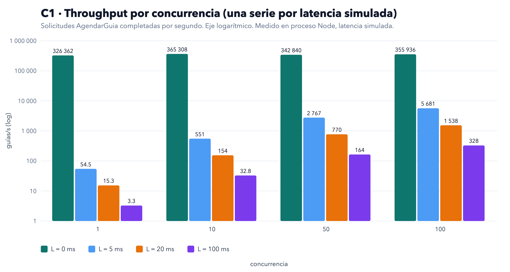

*Evidencia 1. Throughput medido (req/s, eje logarítmico) por concurrencia, una serie por latencia simulada. Fuente: `resultados/matriz.json`.*

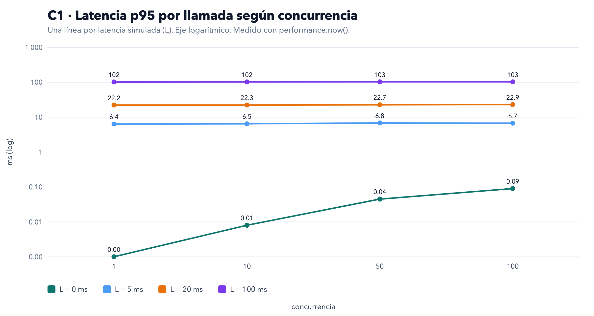

*Evidencia 2. Latencia p95 por llamada (ms, eje logarítmico) por concurrencia y latencia simulada. Fuente: `resultados/matriz.json`.*

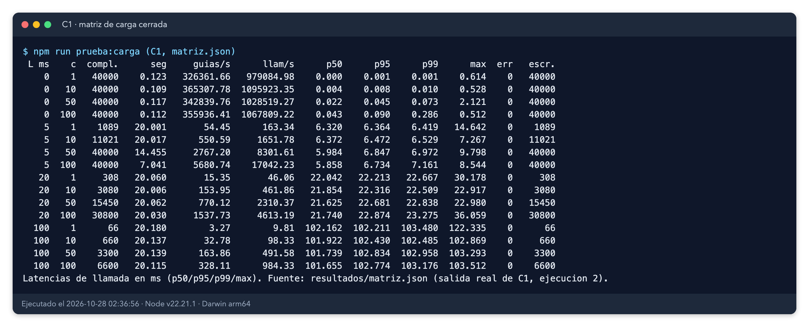

*Evidencia 5. Tabla de la matriz C1 generada desde `resultados/matriz.json` (salida real de C1, sin cambios en los valores).*

### 4.2 C2 · corrida completa del lote (40.000 guías, c = 50, L = 20 ms)

| Medida | Valor | Fuente |
|---|---|---|
| Completadas / errores | 40.000 / 0 | `c2-lote.json` |
| Tiempo total | 51,857 s (0,86 min) | medido |
| Throughput | 771,35 req/s | medido |
| Llamadas a repositorio | 120.000 (p50 21,62 ms, p99 22,85 ms por llamada) | medido |
| Latencia extremo a extremo | p50 64,91 ms, p99 67,49 ms | medido |
| Escrituras reales | 40.000 | medido |
| Verificación final | 40.000 AGENDADA; 0 SIN_COBERTURA (`no_coverage`); 0 versiones > 1; 0 incoherencias; 0 fechas distintas del oráculo | medido |

**Cálculo de referencia (rotulado):** sin sobrecarga, 40.000 × 3 llamadas × 20 ms ÷ 50 = 48,0 s. El tiempo medido (51,9 s) es un 8 % mayor; lo atribuimos a la programación de temporizadores de Node (supuesto, no medido por separado).

**Comparación con el modelo de la Parte A (extrapolado):**
- Ventana de 2 h = 7.200 s. Los 51,9 s medidos son 139 veces menos que la ventana. El umbral del criterio, 5,6 req/s, equivale a 40.000 ÷ 7.143 s, es decir 1 h 59 min.
- Modelo previo a 5 req/s: 40.000 ÷ 5 = 8.000 s = 2 h 13 min (extrapolado, dato de la Parte A).
- Modelo previo a 50 req/s: 40.000 ÷ 50 = 800 s = 13 min 20 s (extrapolado, dato de la Parte A).

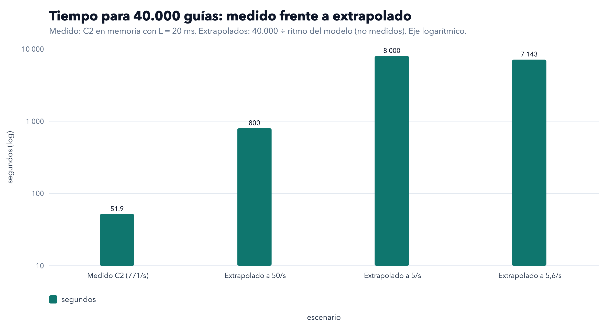

*Evidencia 4. Tiempo para 40.000 guías: el valor medido (51,9 s) frente a los extrapolados a 50, 5 y 5,6 req/s (no medidos; 40.000 ÷ ritmo). Eje logarítmico.*

**Tabla de extrapolación (rotulada: EXTRAPOLADO, 40.000 ÷ throughput medido en C1; no es una medida sobre base de datos ni red):**

| L (ms) | c | req/s medido en C1 | Segundos para 40.000 (extrapolado) |
|---|---|---|---|
| 5 | 50 | 2.767,20 | 14,5 |
| 5 | 100 | 5.680,74 | 7,0 |
| 20 | 10 | 153,95 | 259,8 |
| 20 | 50 | 770,12 | 51,9 |
| 20 | 100 | 1.537,73 | 26,0 |
| 100 | 10 | 32,78 | 1.220,3 |
| 100 | 50 | 163,86 | 244,1 |
| 100 | 100 | 328,11 | 121,9 |

Las filas con c = 1 y las combinaciones de L = 0 se omiten porque no son representativas. Las combinaciones de L = 100 con c = 10 o c = 50 se midieron con tope de 20 s, pero el ritmo sí es válido.

### 4.3 C3 · reanudación tras caída (40.000 guías, c = 50, L = 5 ms)

| Medida | Valor |
|---|---|
| Primera pasada: completadas (se detuvo al 50 %) | 20.049 (50,12 %; las 49 en vuelo terminaron) |
| Primera pasada: escrituras | 20.049 |
| Segunda pasada: completadas | 40.000, 0 errores |
| Segunda pasada: escrituras | 19.951 (esperado 40.000 − 20.049 = 19.951) |
| Escrituras totales reales | 40.000 (esperado 40.000) |
| Guías presentes tras la primera pasada | 20.049 (esperado = completadas) |
| Guías presentes al final | 40.000 |
| Versiones > 1 | 0 (40.000 con versión 1) |
| Incoherencias AGENDADA ⇔ fecha | 0 |
| Fechas distintas del oráculo | 0 |

Resultado: **exacto**. Las escrituras de la segunda pasada son precisamente las guías que no se habían completado.

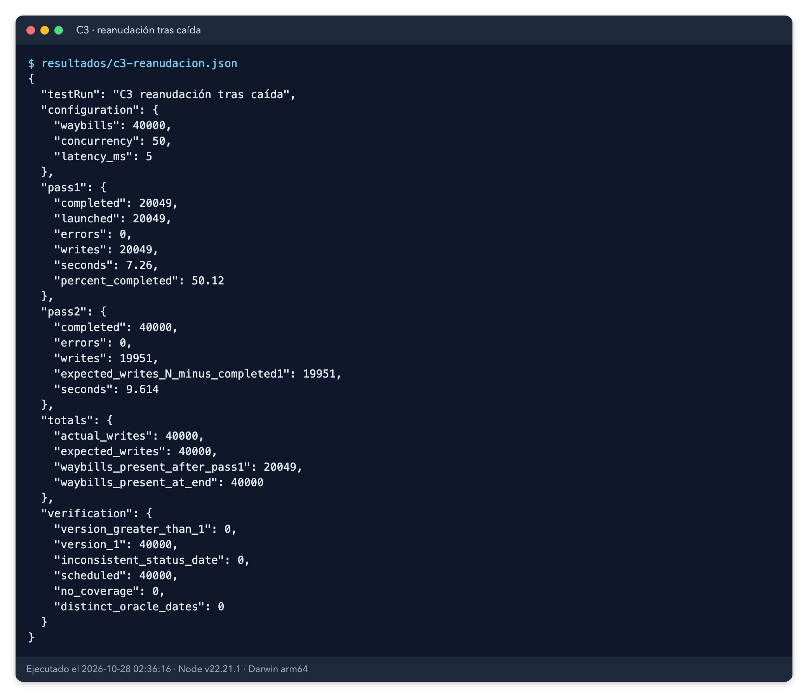

*Evidencia 8. Salida real de C3 (`resultados/c3-reanudacion.json`): escrituras totales 40.000; segunda pasada 19.951 = 40.000 − 20.049.*

### 4.4 C4 · carga abierta (L = 20 ms por llamada, 20 s por tramo)

| Ritmo objetivo | Lanzadas | Completadas | Throughput logrado (req/s) | p50 (ms) | p95 (ms) | p99 (ms) | Máx (ms) | Máx. en vuelo | Retraso máx. de lanzamiento (ms) | Backlog creciente |
|---|---|---|---|---|---|---|---|---|---|---|
| 5 | 100 | 100 | 5,03 | 65,251 | 66,835 | 66,872 | 66,998 | 1 | 2,874 | no |
| 50 | 1.000 | 1.000 | 49,88 | 61,549 | 63,158 | 63,899 | 65,947 | 4 | 2,763 | no |
| 500 | 10.000 | 10.000 | 498,47 | 60,614 | 62,422 | 63,088 | 64,406 | 33 | 1,002 | no |

Criterio a 5 req/s: p99 = 66,872 ms < 200 ms, y sin crecimiento del backlog (media de llamadas en vuelo: 0 en el primer tercio y 0 en el último). **Cumplido.**

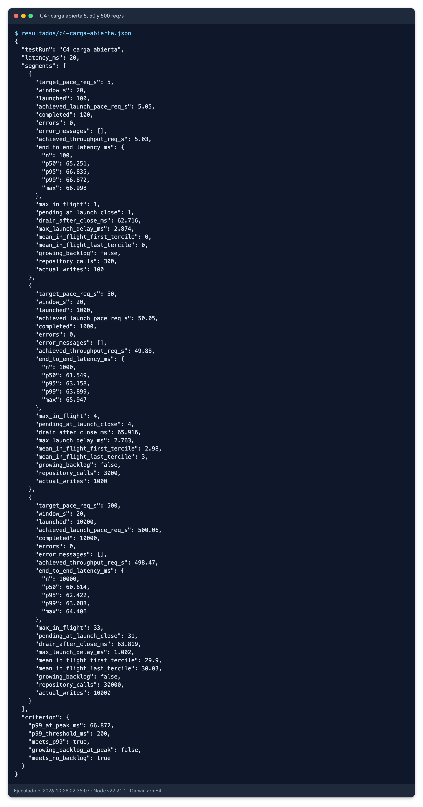

*Evidencia 9. Salida real de C4 (`resultados/c4-carga-abierta.json`), con los tres tramos y el criterio.*

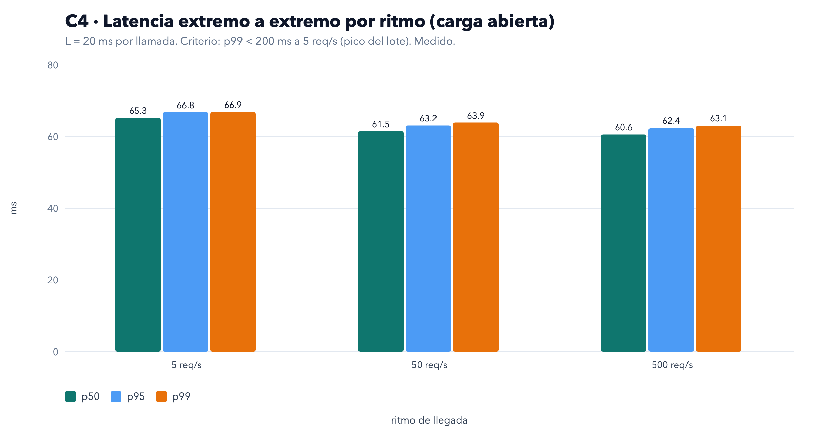

*Evidencia 3. Latencia extremo a extremo (p50, p95 y p99, ms) por ritmo de carga abierta. Fuente: `resultados/c4-carga-abierta.json`.*

Nota: a 5 req/s el p99 se calcula sobre 100 muestras, así que en la práctica es casi el máximo. En el tramo de 500 req/s la media de solicitudes en vuelo fue 29,9 en el primer tercio y 30,0 en el último (máximo 33), así que no hay crecimiento. El retraso máximo del generador (1,0 ms) indica que el lanzamiento se mantuvo cerca del ritmo objetivo (500,06 req/s logrados según `c4-carga-abierta.json`, salida de la ejecución 2).

### 4.5 C5 · memoria (aproximada)

| Medida | Antes de C2 | Después de C2 |
|---|---|---|
| heapUsed (MB) | 11,50 | 39,28 |
| rss (MB) | 64,05 | 105,42 |

Bytes aproximados por guía almacenada (variación ÷ 40.000): **≈ 728 B de heap** y **≈ 1.085 B de rss**. Es aproximado: no se forzó el recolector y la variación incluye basura pendiente de recoger, así que la retención real es menor o igual. Los valores varían entre ejecuciones (ejecución 1: 610 B de heap y 928 B de rss). C5 no tiene criterio de aprobación.

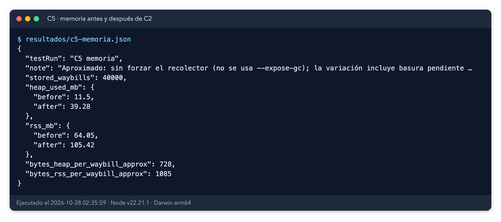

*Evidencia 10. Salida real de C5 (`resultados/c5-memoria.json`).*

### 4.6 Ejecución completa y entorno

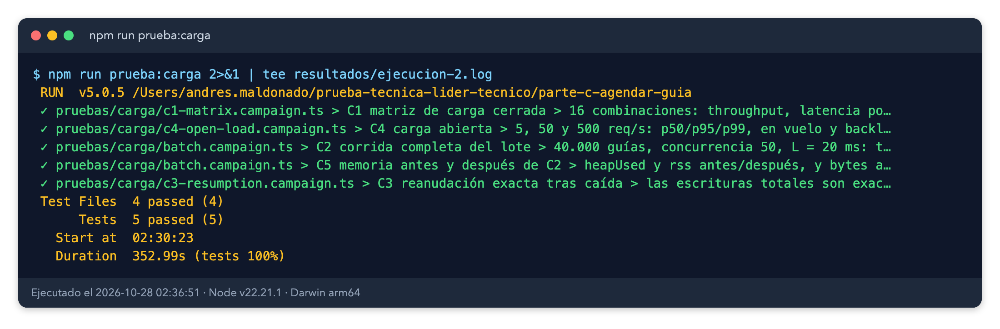

*Evidencia 6. Resumen de `npm run prueba:carga` (`resultados/ejecucion-2.log`): 4 archivos, 5 pruebas, 5 aprobadas, duración 352,99 s.*

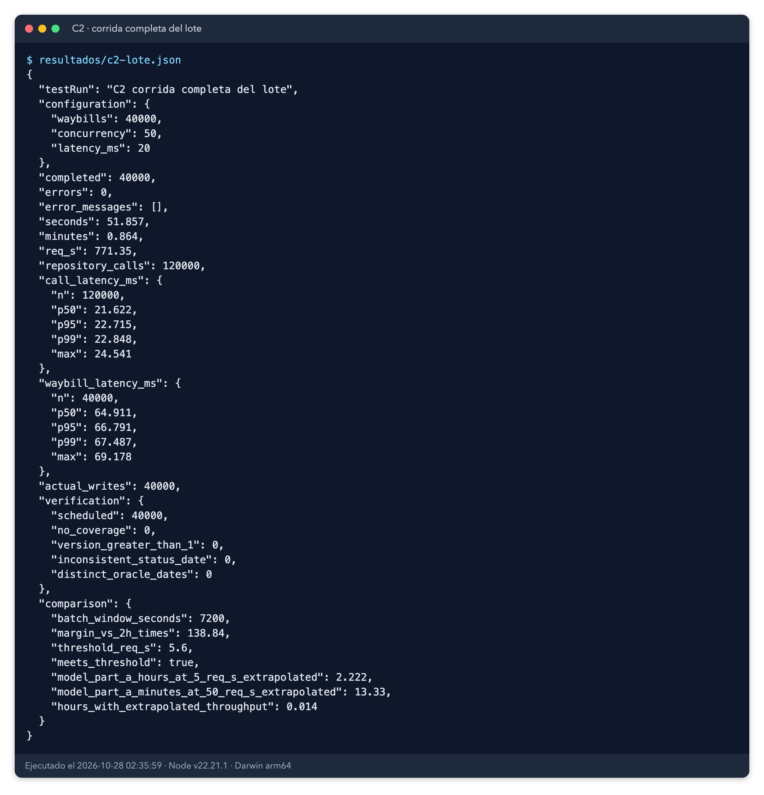

*Evidencia 7. Salida real de C2 (`resultados/c2-lote.json`): 40.000 completadas, 0 errores, 51,857 s, 771,35 req/s.*

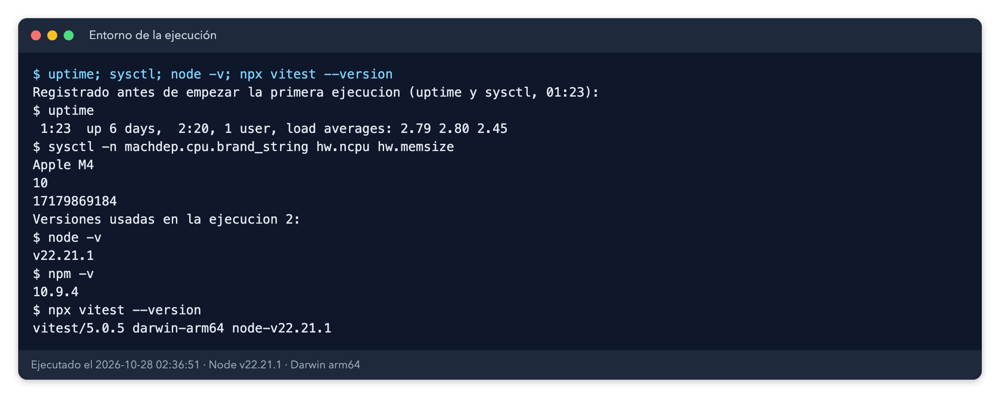

*Evidencia 11. Entorno de la ejecución: uptime y sysctl registrados antes de empezar la ejecución 1, y versiones de Node, npm y Vitest (`resultados/entorno.txt`).*

## 5. Comparación con la corrida anterior (ejecución 1, nombres en español)

La lógica no cambió; cambiaron los nombres y la configuración por variables de entorno (sin variables, el comportamiento es el mismo). Las diferencias de rendimiento se deben a ruido de temporizadores y del sistema, no a un cambio de lógica. Son comparaciones de una sola corrida por versión; no se repitieron para estimar la dispersión.

| Medida | Ejecución 1 | Ejecución 2 | Diferencia |
|---|---|---|---|
| C2 tiempo (s) | 50,245 | 51,857 | +3,2 % |
| C2 req/s | 796,1 | 771,35 | −3,1 % |
| C2 p99 por llamada (ms) | 21,93 | 22,85 | +4 % |
| C1 L = 20, c = 50 (req/s) | 770,5 | 770,12 | ≈ 0 % |
| C1 L = 20, c = 100 (req/s) | 1.539,17 | 1.537,73 | ≈ 0 % |
| C1 L = 5, c = 50 (req/s) | 3.014,30 | 2.767,20 | −8,2 % |
| C1 L = 5, c = 100 (req/s) | 6.077,43 | 5.680,74 | −6,5 % |
| C4 p99 a 5 req/s (ms) | 67,165 | 66,872 | −0,4 % |
| C4 p99 a 500 req/s (ms) | 63,093 | 63,088 | ≈ 0 % |
| C3 escrituras totales | 40.000 | 40.000 | igual |
| C3 completadas en la primera pasada | 20.049 | 20.049 | igual |

Lectura honesta: los escenarios con temporizadores de 20 ms y de 100 ms son estables (diferencias de 0 a 4 %). Las diferencias mayores (−6 % a −8 %) aparecen en L = 5 ms con concurrencia alta, donde los temporizadores de 5 ms son más sensibles al ruido del sistema; no bastan para afirmar una regresión. Ninguna cifra cambia una conclusión: todos los criterios siguen cumplidos con holgura. Si se quisiera confirmar, haría falta repetir la matriz varias veces y comparar la dispersión.

## 6. Hallazgos y correcciones

**Sin hallazgos de producto.** Todos los criterios se cumplieron en la ejecución 2: 0 errores en las 16 combinaciones, en C2, C3 y C4; escrituras = completadas; reanudación exacta; p99 a 5 req/s de 66,9 ms (umbral 200 ms); throughput de C2 de 771 req/s (umbral 5,6).

Incidencias del harness durante la regeneración (no son defectos del caso de uso):
1. **C1 falló en la primera ejecución de la regeneración** porque el bucle de aserciones de `c1-matrix.campaign.ts` seguía leyendo las claves antiguas (`errores`, `escrituras_igual_completadas`, `cumple_throughput`, `latencia_ms`, `concurrencia`) tras la traducción. Se corrigió a `errors`, `writes_equal_completed`, `meets_throughput`, `latency_ms` y `concurrency`. La matriz ya se había escrito bien; el fallo era solo de aserción. Tras la corrección, la suite completa pasó.
2. **Desbordamiento de pila** en `Math.max(...valores)` sobre 120.000 valores, corregido en la ejecución 1 (cálculo por reducción).
3. **Borrado bloqueado:** el chequeo de seguridad de la herramienta bloqueó un `rm` que usaba una variable de shell. Se repitió con ruta absoluta literal, acotada a `pruebas/carga/evidencias/*.png`.

Por qué se puede confiar en el resultado, con sus límites:
- Los datos están generados para que toda guía tenga cita, de modo que C3 sea exacta (ver sección 6, límites). Esa garantía se aplica en el generador, no en `src/`.
- No se detectó contención sobre la misma guía. Ver sección 6.

## 7. Conclusiones, límites y riesgos residuales

**Conclusión frente al criterio de aprobación:** el caso de uso cumple todos los criterios de la campaña en un proceso Node con repositorios en memoria y latencia simulada. El cuello de botella medido es la latencia inyectada, no el código: a L = 0 el caso de uso procesa unas 340.000 guías/s, es decir, un coste de CPU de unos 3 µs por guía, muy por debajo de cualquier latencia real de base de datos.

**Qué NO prueba este informe** (todo lo siguiente es extrapolación o no se midió):
- **Latencia real de base de datos.** Las cifras de 771 req/s o 5.681 req/s dependen del valor simulado. Con PostgreSQL y red reales, la latencia por llamada sería distinta y el throughput efectivo sería menor. Cualquier cifra de capacidad para producción es **extrapolada**.
- **Red, Cloud Run, Pub/Sub, JWT, TLS, RLS.** No medidos (no existen en la Parte C).
- **Contención real sobre la misma guía.** Las pruebas usan guías distintas por solicitud. El control optimista (`VersionConflict`, dos intentos) se probó en pruebas funcionales, no bajo carga. El README afirma que «dos solicitudes simultáneas dan la misma cita y una sola escritura»: **esa afirmación no se midió aquí.** Queda como riesgo residual para una campaña siguiente.
- **`SystemClock`** (zona America/Bogota, formateador por llamada) y los ajustes `SCHEDULING_*` no se ejercitaron: la prueba usa `FixedClock` y los valores por defecto.
- **Memoria** (C5) es aproximada, sin recolector forzado.
- **Carga abierta** con 100 muestras a 5 req/s: el p99 es casi el máximo.
- **Dispersión entre ejecuciones:** solo hay dos corridas; las diferencias de la sección 5 no son una estimación estadística.

**Riesgos residuales y pasos siguientes:**
1. Repetir C2 y C4 contra PostgreSQL real en un entorno de prueba para obtener latencia medida (sustituye la extrapolación).
2. Añadir un escenario de contención: varias solicitudes simultáneas sobre la misma guía, para medir escrituras y conflictos.
3. Medir `SystemClock` por separado si entra en el camino caliente.
4. Repetir la matriz varias veces para estimar la dispersión.

**Veredicto:** verificada con los límites descritos. El lote de 40.000 guías en unos 52 s de cómputo local deja holgura frente a las 2 h de la ventana, pero la validación real de la ventana exige la prueba en base de datos.
