# Informe de prueba de estrés: caso de uso «Agendar una guía» (Parte C)

**Autor:** Andres Maldonado · **Rol:** Líder Técnico · **Fecha:** 2026-10-28 · **Estado:** verificada (0 hallazgos de defecto; 4 observaciones)

**Resumen ejecutivo:** Se regeneró la prueba tras traducir el código al inglés. Se ejecutó `npm run prueba:estres` una vez completa: 9 casos en 6 archivos, 79,4 s, **9 de 9 pasan**. Con 120.000 guías, 10.000 solicitudes sobre una misma guía, 50.000 solicitudes duplicadas, 50.000 solicitudes en vuelo, tres tasas de fallo y 1.000.000 de llamadas idempotentes no hubo corrupción, duplicados, errores no esperados ni fuga de memoria; no hubo unhandledRejection ni uncaughtException. **Cambio frente a la corrida anterior:** el punto de quiebre de E4 queda ahora en N = 50.000 por latencia (p99 de 321,4 ms frente a 5 × 63,2 ms), cuando antes no se alcanzaba. La validación por mutación detecta 3 de 3 roturas deliberadas. Todas las latencias son simuladas: no describen red, PostgreSQL ni Cloud Run.

## 1. Objetivo y alcance

Se prueba el caso de uso `ScheduleWaybill` y su control optimista de versión bajo carga, contención, fallos inyectados y ejecución prolongada. Los escenarios buscan respuestas a cuatro preguntas: si el lote de 3× mantiene la integridad, si la concurrencia sobre una misma guía produce escrituras de más, si los fallos transitorios dejan datos corruptos y si la reanudación es exacta, y si la memoria crece con las llamadas repetidas.

Alcance: el caso de uso, el dominio y los adaptadores en memoria `InMemoryWaybillRepository` y `InMemoryCoverageRepository`, con latencia simulada por operación (lectura de guía, lectura de cobertura y escritura). Cada solicitud hace tres operaciones: lectura de guía, lectura de cobertura y escritura.

**Fuera de alcance:** red, PostgreSQL, Cloud Run, Pub/Sub, JWT, TLS, RLS, el reloj de producción y cualquier latencia real. Todo número de latencia o de throughput es de la simulación y se rotula «simulada». Lo que se derive para un entorno real se rotula «extrapolado» en la sección 7.

## 2. Entorno y herramientas

| Elemento | Valor |
|---|---|
| Máquina | Apple M4, 10 CPU, 16 GB RAM (`sysctl`) |
| Carga | La última medición de carga inicial es de la corrida anterior (01:42): `load averages: 5.29 5.18 4.18`, con `fileproviderd` a 141,7 % de CPU. Para esta corrida no se midió la carga antes de empezar; el registro del entorno (`resultados/entorno.txt`) se tomó al final |
| Node / npm | v22.21.1 / 10.9.4 |
| Herramientas | Vitest 5.0.5, TypeScript (tsc sin errores sobre `src/`, `test/` y `pruebas/estres/`), `--expose-gc` (`global.gc` disponible) |
| Commit del código probado | `d97161b`. `src/` tiene 8 cambios sin confirmar (renombrado al inglés y configuración por variables de entorno); no se hizo ningún commit |
| Comandos | `npm run prueba:estres` (suite completa, 1 vez; log en `resultados/ejecucion-2.log`); `npm run prueba:estres:contencion` (E2 y E3); `python3 pruebas/_comun/mutaciones.py pruebas/estres/mutaciones.json pruebas/estres/resultados/mutaciones.log` |
| Logs crudos | `resultados/ejecucion-2.log`, `resultados/e1-volumen.json` … `resultados/e6-memoria.json`, `resultados/entorno.txt`, `resultados/mutaciones.log`. Corrida anterior en `resultados/anterior/` |

**Archivos de la prueba** (`pruebas/estres/`): `configuration.ts` (variables y constantes), `common.ts` (datos, montaje, pool, estadística, memoria, vigilancia de errores), y los campañas `e1-volume.campaign.ts`, `e2-burst.campaign.ts`, `e3-contention.campaign.ts`, `e4-steps.campaign.ts`, `e5-failures.campaign.ts`, `e6-memory.campaign.ts`. Las mutaciones están en `mutaciones.json`.

**Nombres de la traducción.** `AgendarGuia` → `ScheduleWaybill`; `GuiaRepositoryEnMemoria` → `InMemoryWaybillRepository`; `CoberturaRepositoryEnMemoria` → `InMemoryCoverageRepository`; `ConflictoDeVersion` → `VersionConflict`; `ErrorInyectado` → `InjectedError`; `FechaCivil` → `CivilDate`; `Guia` → `Waybill`; `Cobertura` → `Coverage`; `Reloj` → `Clock`. Los valores de estado (`AGENDADA`, `SIN_COBERTURA`) y los mensajes siguen en español.

**Cambio en el caso de uso.** `ScheduleWaybill` acepta un cuarto parámetro opcional de ajustes. La prueba no lo pasa, así que usa `DEFAULT_SETTINGS` (`conflictAttempts` = `ATTEMPTS_ON_CONFLICT` = 2), igual que antes. Las variables `SCHEDULING_*` que lee `settingsFromEnvironment` no intervienen en la prueba.

**Variables de entorno de la prueba.** Valores por defecto y validación en `pruebas/estres/configuration.ts`. Un valor no válido aborta con un mensaje que nombra la variable.

| Variable | Defecto | Significado |
|---|---|---|
| `STRESS_SEED` | 20261028 | Semilla de datos y de fallos |
| `STRESS_BATCH_BASE` | 40000 | Guías del lote base de E1 |
| `STRESS_FACTOR` | 3 | Múltiplo de E1: 3 × 40.000 = 120.000 |
| `STRESS_BURST` | 10000 | Solicitudes simultáneas sobre una misma guía (E2) |
| `STRESS_DUP_GUIDES` | 1000 | Guías distintas en E3 |
| `STRESS_DUPLICATES` | 50 | Solicitudes por guía en E3 |
| `STRESS_STEPS` | 100,500,1000,5000,10000,20000,50000 | Escalones de E4 (deben ser crecientes) |
| `STRESS_MAX_CONCURRENT` | 50000 | Tope de solicitudes en vuelo; recorta los escalones de E4 |
| `STRESS_RSS_LIMIT_MB` | 4096 | Si el RSS lo supera en E4, se detienen los escalones |
| `STRESS_FAILURE_RATES` | 0.05,0.15,0.30 | Tasas de fallo por operación de E5, en (0, 1) |
| `STRESS_FAILURE_GUIDES` | 20000 | Guías por tasa en E5 |
| `STRESS_MEMORY_OPS` | 1000000 | Llamadas idempotentes de E6b |
| `STRESS_MEMORY_GUIDES` | 10000 | Guías agendadas sobre las que se repiten las llamadas de E6b |
| `STRESS_MEMORY_NEW_GUIDES` | 100000 | Guías nuevas de E6a. **Variable añadida**: el enunciado la fijaba en 100.000 |
| `STRESS_MEMORY_STEP` | 100000 | Cada cuántas operaciones se mide el heap en E6b. **Variable añadida** |

Parámetros de la especificación que no son de escala (concurrencia 50 en E1 y E5, latencias 5 ms y 20 ms, «hoy» = 2026-10-28, umbrales de quiebre) están como constantes con comentario en `configuration.ts`.

## 3. Escenarios

| ID | Escenario | Criterio de aceptación | Trazabilidad (Parte A) |
|---|---|---|---|
| E1 | 120.000 guías distintas, concurrencia 50, L = 5 ms | 120.000 escrituras reales exactas, 0 errores, 0 discrepancias con el oráculo | H2.4 (3×); §3 Datos (versión monótona); §4 (integridad) |
| E2 | 10.000 solicitudes simultáneas sobre una misma guía, L = 5 ms | Misma cita en todas, 1 escritura real, 0 errores, versión 1 | §3 Datos (un solo escritor por guía); §4 |
| E3 | 1.000 guías × 50 duplicados, todas en vuelo, L = 5 ms | 1.000 escrituras reales exactas, versión 1, 0 errores, misma respuesta por guía | §3 Datos; §4 |
| E4 | Escalones N = 100 … 50.000, N guías en vuelo, L = 20 ms | 0 errores y escrituras = N en cada escalón; quiebre documentado | H2.4; §6 riesgo 4 (lote) |
| E5 | Fallos inyectados p ∈ {5, 15, 30} %, 20.000 guías, concurrencia 50, L = 5 ms; reanudación | Fallos solo `InjectedError`; ninguna guía corrupta; escrituras totales = 20.000 tras reanudar | §6 riesgo 4 (lote reanudable); §4 |
| E6a | 100.000 guías nuevas tras gc, bytes por guía | Escrituras = guías; medición de bytes | §4 (integridad); §6 riesgo 4 |
| E6b | 1.000.000 llamadas idempotentes sobre 10.000 guías agendadas, L = 0 | Sin escrituras; coherencia; heap tras gc entre 100.000 y 1.000.000 crece como máximo max(10 %, 20 MB) | §6 riesgo 4 (reanudación sin fugas) |

Resultado: 9 casos, 9 pasaron, 0 fallaron (E1, E2, E3, E4, E5 p = 5/15/30 %, E6a, E6b).

## 4. Resultados y evidencias

### 4.1 E1 volumen 3× y E2 ráfaga

| ID | Resultado | Observación |
|---|---|---|
| E1 | OK | 120.000 guías completadas, 0 errores. Escrituras reales = 120.000. Auditoría contra el oráculo: 0 corruptas, 0 versión ≠ 1, 0 cita distinta. Tiempo 43,32 s, 2.770,4 guías/s (simulada). Latencia por solicitud: p50 18,08 ms, p99 20,47 ms, máx 25,52 ms. Heap antes 19,4 MB, tras el lote 58,3 MB, tras gc 47,8 MB. RSS 88,7 → 121,0 MB |
| E2 | OK | 10.000 solicitudes, 0 errores. Escrituras reales = 1. Intentos de escritura = 10.000. Conflictos de versión = 9.999 (= BURST − 1, el valor esperado si todas leen antes de la primera escritura). Lecturas de guía = 19.999 (10.000 + 9.999 reintentos). Respuestas distintas = 1 (`AGENDADA|2026-10-29`, igual al oráculo). Versión final 1. Tiempo 0,143 s; latencia p50 124,5 ms, p99 127,7 ms |

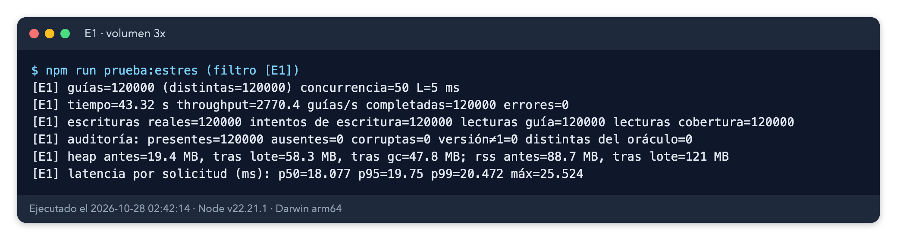

*Evidencia 6. Salida real de E1 en captura de terminal (`resultados/salida-e1.txt`): 120.000 guías, 0 errores, escrituras = 120.000.*

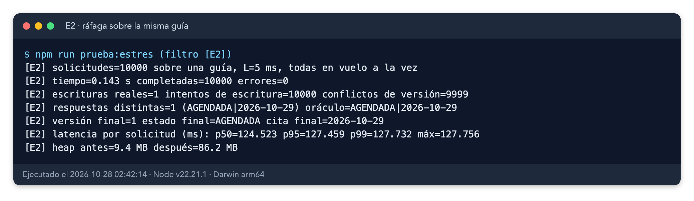

*Evidencia 7. Salida real de E2: 10.000 solicitudes sobre una guía, 1 escritura, 9.999 conflictos resueltos por reintento.*

### 4.2 E3 contención mixta

| ID | Resultado | Observación |
|---|---|---|
| E3 | OK | 50.000 solicitudes (1.000 guías × 50), todas en vuelo, 0 errores. Escrituras reales = 1.000 exactas. Intentos de escritura = 50.000. Conflictos = 49.000. Versión 1 en las 1.000 guías. 0 guías con respuestas distintas entre sus duplicados. Tiempo 0,66 s; latencia p50 558,4 ms, p99 626,1 ms, máx 652,0 ms. Heap 9,8 → 287,7 MB y RSS 410 MB tras el escenario, con 50.000 resultados retenidos |

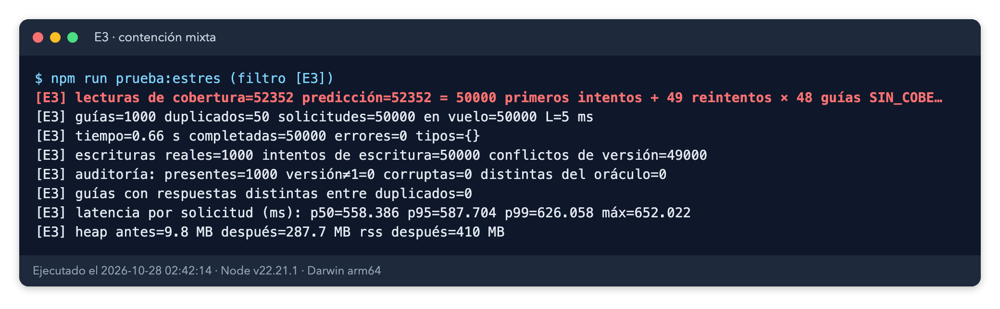

*Evidencia 8. Salida real de E3: 1.000 escrituras para 50.000 solicitudes, 0 errores, versión 1 en todas las guías.*

**La cifra de lecturas de cobertura (52.352 frente a 50.000 solicitudes), explicada y comprobada.** La prueba ahora mide la causa y la predicción sale del mismo log: `lecturas de cobertura=52352 predicción=52352 = 50000 primeros intentos + 49 reintentos × 48 guías SIN_COBERTURA`. Cada primer intento lee la cobertura, porque todos los duplicados ven la guía como pendiente. Un reintento vuelve a leer la cobertura solo si la guía sigue sin agendar, es decir, si quedó `SIN_COBERTURA`. Esas guías no escriben y sí se pueden reintentar, como está diseñado. Con 48 guías en esa situación y 49 reintentos por guía: 48 × 49 = 2.352. La predicción coincide exactamente con lo medido, sin ajustes.

### 4.3 E4 escalones de concurrencia

| N (en vuelo) | Tiempo (s) | Guías/s | p50 (ms) | p95 (ms) | p99 (ms) | Máx (ms) | Errores | Retardo bucle p99 (ms) | RSS máx (MB) |
|---|---|---|---|---|---|---|---|---|---|
| 100 | 0,064 | 1.572 | 63,17 | 63,21 | 63,22 | 63,26 | 0 | 12,1 | 64,2 |
| 500 | 0,067 | 7.449 | 62,11 | 66,30 | 66,33 | 66,34 | 0 | 12,1 | 66,5 |
| 1.000 | 0,068 | 14.681 | 63,52 | 66,63 | 66,65 | 66,67 | 0 | 12,7 | 75,6 |
| 5.000 | 0,084 | 59.840 | 65,62 | 71,69 | 71,80 | 71,84 | 0 | 19,8 | 113,6 |
| 10.000 | 0,089 | 112.069 | 70,52 | 74,19 | 74,47 | 75,91 | 0 | 19,7 | 141,7 |
| 20.000 | 0,151 | 132.118 | 119,73 | 124,02 | 124,64 | 124,81 | 0 | 27,1 | 212,3 |
| 50.000 | 0,395 | 126.437 | 316,35 | 320,28 | **321,40** | 321,94 | 0 | 99,5 | 398,8 |

Todos los escalones: escrituras = N, 0 incoherencias, 0 errores, RSS máximo 398,8 MB < 4.096 MB (no se detuvo la prueba). **Punto de quiebre: escalón 50.000, por latencia.** Su p99 es 321,40 ms, mayor que 5 × 63,22 ms = 316,08 ms (el p99 del primer escalón). Por errores y por retardo del bucle (99,5 ms frente a 1.000 ms) no hay quiebre.

La conclusión depende de la corrida. En la corrida anterior el mismo escalón dio 311,64 ms (4,96 veces), sin quiebre. Con una sola corrida por escenario, el cociente de 5 veces está dentro de la variación entre corridas (~1–2 % del p99), así que el quiebre en 50.000 debe leerse como «en el límite», no como un valor firme. Retardo del bucle: el mínimo de 12 ms es la resolución del monitor (10 ms), no un bloqueo. Cada escalón tuvo solo 3 a 5 muestras de retardo; esas cifras son orientativas.

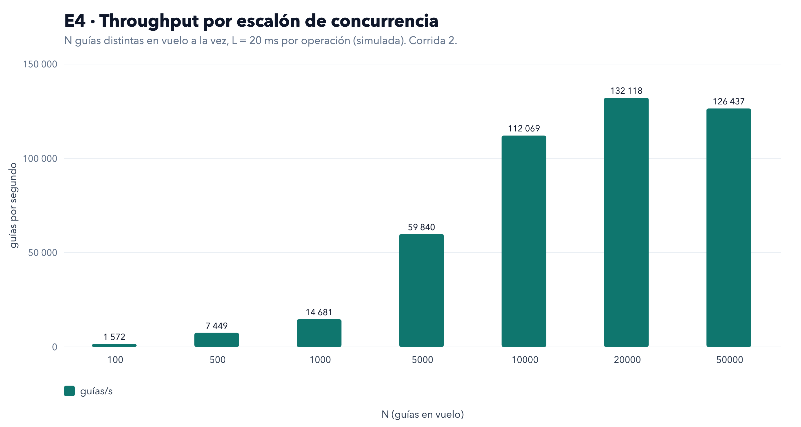

*Evidencia 1. Throughput (guías/s) por escalón de E4, medido en el proceso Node con latencia simulada de 20 ms por operación. Crece con N porque todas las solicitudes están en vuelo y la espera simulada se solapa.*

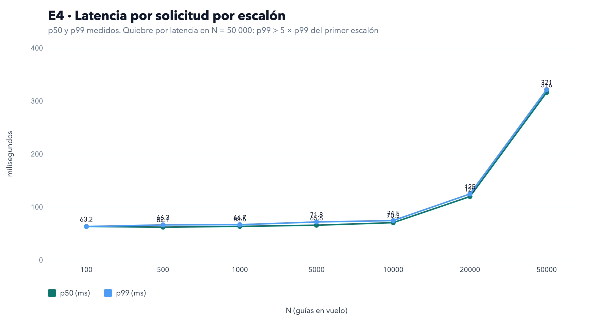

*Evidencia 2. Latencia por solicitud (p50 y p99) por escalón de E4. A partir de 10.000 en vuelo la latencia sube por la carga de CPU del propio proceso, no por el almacén.*

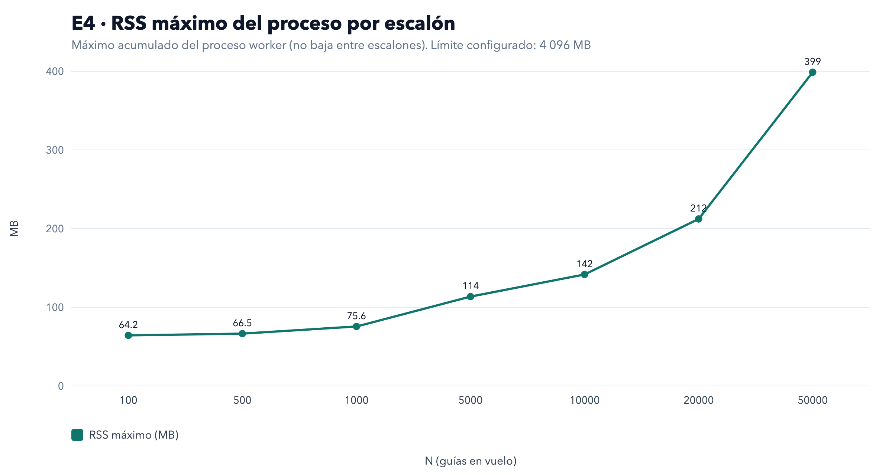

*Evidencia 3. RSS máximo por escalón de E4. Es un máximo acumulado del proceso worker: no baja entre escalones.*

### 4.4 E5 fallos inyectados y reanudación

| Tasa p | Completadas (pasada 1) | Fallidas | Observada (llamadas) | IC95 Wilson | Teórica 1−(1−p)³ | Fallos por operación | Escrituras en reanudación | Escrituras totales |
|---|---|---|---|---|---|---|---|---|
| 5 % | 17.161 | 2.839 | 14,20 % | [13,72; 14,69] % | 14,26 % | 4,97 % (teórico 5 %) | 2.839 | 20.000 |
| 15 % | 12.220 | 7.780 | 38,90 % | [38,23; 39,58] % | 38,59 % | 15,12 % (teórico 15 %) | 7.780 | 20.000 |
| 30 % | 6.778 | 13.222 | 66,11 % | [65,45; 66,76] % | 65,70 % | 30,20 % (teórico 30 %) | 13.222 | 20.000 |

En las tres tasas: todos los fallos son `InjectedError`; 0 guías corruptas; 0 versiones distintas de 1; ninguna cita distinta del oráculo; escrituras de la pasada 1 = llamadas completadas; reanudación con 0 errores; escrituras totales = 20.000 exactas. La tasa teórica cae dentro del IC95 en las tres tasas. Los resultados son idénticos a la corrida anterior porque la semilla fija los fallos. Cálculo: 3 operaciones por llamada, ya que una llamada falla si falla alguna de las operaciones que intenta, y eso no depende del orden. El número medio de operaciones intentadas es menor que 3 por llamada (57.089 operaciones para 20.000 llamadas al 5 %), así que la fórmula sirve para la probabilidad de llamada fallida y no para contar operaciones.

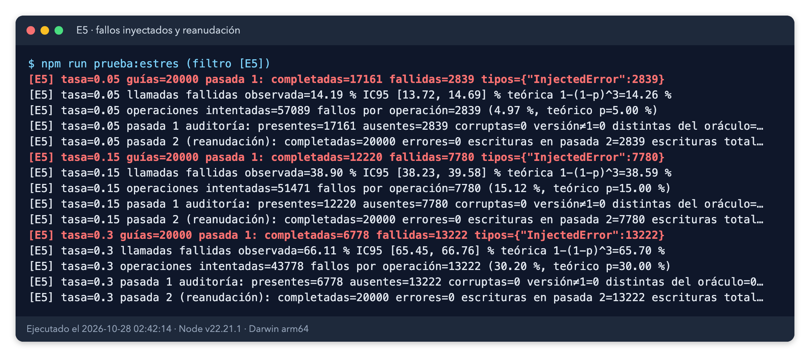

*Evidencia 9. Salida real de E5. Las líneas largas se cortan a 112 columnas en la captura; el texto completo está en `resultados/salida-e5.txt`.*

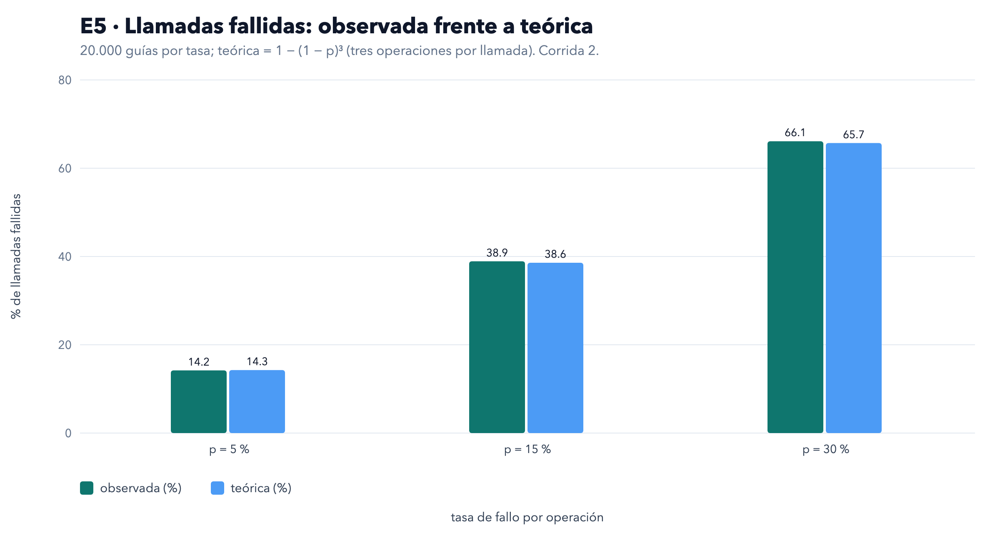

*Evidencia 4. Llamadas fallidas observadas frente a la tasa teórica 1 − (1 − p)³ para p = 5, 15 y 30 %, con 20.000 guías por tasa.*

### 4.5 E6 memoria y fugas

- **E6a (bytes por guía).** 100.000 guías nuevas: escrituras reales = 100.000. Heap tras gc 9,4 MB → 36,6 MB, crecimiento 28.548.728 bytes, es decir 285 bytes por guía. Incluye el `Map` del repositorio, la copia de cada guía y sus objetos de valor. *Extrapolado:* 120.000 guías × 285 bytes ≈ 34,2 MB; no se midió a 120.000 en una sola corrida.
- **E6b (fuga).** 1.000.000 llamadas idempotentes sobre 10.000 guías agendadas, L = 0: tiempo 1,06 s, 0 escrituras durante las llamadas, 0 incoherencias. Heap tras gc: 13,6 MB (inicio), 13,6 MB (100.000), 13,7 MB (1.000.000). Crecimiento entre 100.000 y 1.000.000 operaciones: 93.200 bytes (≈ 0,7 % de 13,6 MB), frente a un límite de max(10 %, 20 MB) = 20,97 MB. **Cumple.**

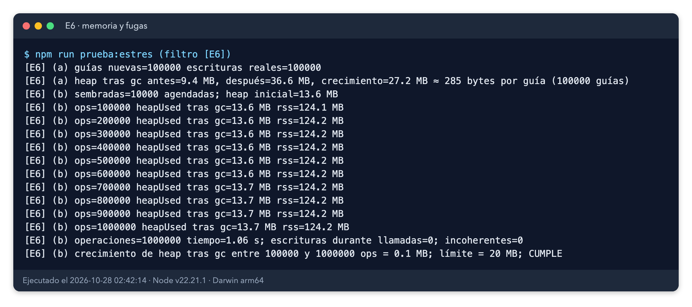

*Evidencia 10. Salida real de E6a y E6b: crecimiento de heap de 0,1 MB en 1.000.000 operaciones.*

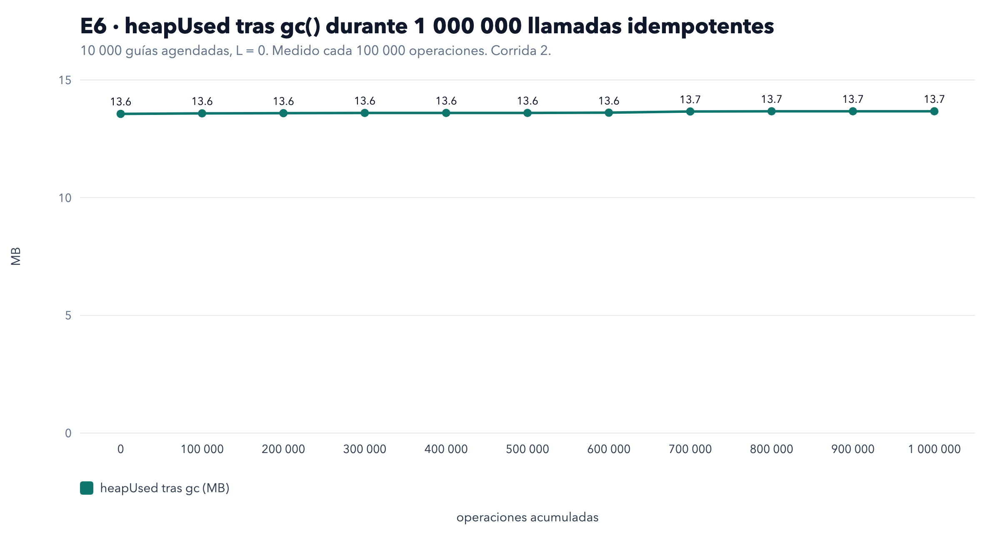

*Evidencia 5. heapUsed tras gc() cada 100.000 operaciones en E6b. La línea es plana.*

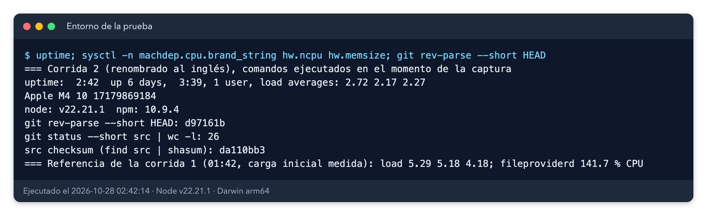

*Evidencia 11. Registro del entorno: uptime, `sysctl`, versión de Node, commit y cambios sin confirmar en `src/`.*

## 5. Comparación con la corrida anterior

La corrida anterior (`resultados/anterior/`) usaba los nombres en español. Mismos datos, misma semilla, mismos criterios.

| Medida | Corrida anterior | Esta corrida | Lectura |
|---|---|---|---|
| E1 tiempo / guías/s | 43,07 s / 2.785,9 | 43,32 s / 2.770,4 | Variación de tiempo de ~0,6 % |
| E1 p99 de latencia (simulada) | 20,03 ms | 20,47 ms | Igual orden |
| E2 conflictos / escrituras | 9.999 / 1 | 9.999 / 1 | Igual |
| E3 lecturas de cobertura | 52.352 | 52.352 | Igual; ahora explicada por la predicción exacta |
| E3 p99 / heap tras el escenario | 645,3 ms / 323,8 MB | 626,1 ms / 287,7 MB | El heap depende de los resultados retenidos y del recolector |
| E4 p99 en N = 50.000 | 311,64 ms (4,96 ×) | 321,40 ms (5,09 ×) | **Cambia la conclusión: quiebre por latencia en 50.000** |
| E4 quiebre | no alcanzado hasta 50.000 | escalón 50.000 (latencia) | Dentro de la variación entre corridas |
| E5 todas las cifras | — | idénticas | Semilla fija |
| E6a bytes por guía / E6b crecimiento | 286 / 96.264 bytes | 285 / 93.200 bytes | Igual orden; cumple |
| Mutaciones detectadas | 3 de 3 | 3 de 3 | Igual |

## 6. Validación de las pruebas por mutación

Para comprobar que las pruebas de contención no son decorativas, se rompió el producto a propósito de tres formas y se ejecutó `npm run prueba:estres:contencion` (E2 y E3). Un ciclo completo de mutaciones con la línea base tomó pocos segundos; la suite completa de E1–E6 tomó 79,4 s en esta corrida. El script toma un bloqueo de archivo y restaura `src/` al terminar. Comprobaciones posteriores: el checksum de `src/` es igual antes y después (`da110bb3…`), no hay `if (false)` en `src/` y `ATTEMPTS_ON_CONFLICT` vale 2. Los JSON de E2 y E3 se respaldaron antes de las mutaciones y se restauraron después, porque la suite de contención los sobrescribe con los datos mutados.

| ID | Rotura deliberada | Pruebas que fallan | Resultado |
|---|---|---|---|
| X-M1 | el repositorio ignora los conflictos de versión | 2 de 2 | Detectada |
| X-M2 | sin reintento ante conflicto (un solo intento) | 2 de 2 | Detectada |
| X-M3 | sin idempotencia: una guía agendada se recalcula | 2 de 2 | Detectada |

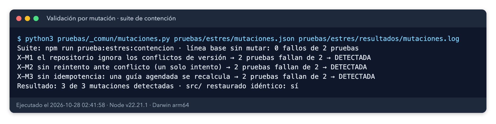

*Evidencia 12. Salida real de `mutaciones.log`: línea base sin mutar con 0 fallos, 3 de 3 mutaciones detectadas y `src/` restaurado idéntico.*

## 7. Hallazgos, conclusiones, límites y riesgos residuales

**Hallazgos de defecto: ninguno.** Ningún criterio de aprobación falló. Los 9 casos pasaron, sin corrupción, duplicados, errores no esperados ni fuga.

Observaciones (no son defectos; se registran para decidir):

| ID | Severidad | Observación | Evidencia | Estado |
|---|---|---|---|---|
| O1 | Informativo | Amplificación por contención: con una sola guía, 10.000 solicitudes producen 9.999 conflictos de versión; con 1.000 guías × 50 duplicados, 49.000 conflictos para 1.000 escrituras (98 % de los intentos de escritura). El reintento es inmediato y solo hay uno. No afecta a la corrección, pero en PostgreSQL cada conflicto sería una ida y vuelta extra por solicitud duplicada en el lote | Evidencias 7 y 8 | Abierto |
| O2 | Bajo | Quiebre por latencia en E4 a N = 50.000 (p99 321,40 ms > 316,08 ms). El cociente frente al primer escalón es 5,09 en esta corrida y 4,96 en la anterior. Es un límite de CPU del propio proceso (retardo del bucle 99,5 ms), no un error de corrección | Evidencia 2 | Abierto |
| O3 | Informativo | El monitor de retardo del bucle tiene resolución de 10 ms y ventanas de 60 a 400 ms: 3 a 5 muestras por escalón. Sus cifras son orientativas; el criterio de quiebre por retardo nunca se activó | Evidencia 2 | Abierto |
| O4 | Informativo | Las lecturas de cobertura de E3 (52.352) superan las 50.000 solicitudes por el reintento diseñado de las guías `SIN_COBERTURA`. Explicado y verificado con la predicción exacta de la prueba | Sección 4.2 | Cerrado |

**Conclusión frente al criterio de aprobación.** Se cumplen los cinco requisitos en la simulación: 0 corrupción ni duplicados (E1–E3, E5); E1–E4 con 0 errores; en E5 todos los fallos son `InjectedError` y la reanudación es exacta (20.000 escrituras totales); E6 sin fuga; 0 unhandledRejection y 0 uncaughtException en los seis archivos. Quiebre documentado: escalón 50.000 por latencia, en el límite. Estado: **verificada**.

**Qué demuestra este informe.** Que la lógica de agendamiento y su control optimista mantienen integridad con el volumen de 3×, con contención sobre una misma guía, con fallos transitorios del 5 al 30 % y con reanudación. Que el caso de uso no pierde memoria en un millón de llamadas repetidas. Que, dentro de un proceso Node, la sobrecarga del caso de uso crece de forma razonable hasta 50.000 solicitudes en vuelo.

**Qué NO demuestra este informe.**
- Latencia real de red, PostgreSQL, Cloud Run ni Pub/Sub. Todas las latencias son simuladas (5 ms o 20 ms por operación) y no sirven para estimar tiempos de un entorno real.
- Concurrencia real. Tener 50.000 solicitudes en vuelo sobre un pool de conexiones real no es realista; aquí no hay pool. La cifra de E4 mide el coste del proceso, no el de la base de datos.
- Ausencia de cuello de botella externo. El punto de quiebre de E4 es el de este proceso con latencia simulada, no el del sistema.
- Firmeza del quiebre de E4. Cada escenario se ejecutó una vez; dos corridas dan 4,96 y 5,09 veces. Hacen falta repeticiones para fijar el quiebre.
- Pico de memoria real. El muestreo de RSS solo ve el proceso cuando su bucle está libre, así que el máximo puede subestimar el pico.
- Equipo en reposo. Para esta corrida no se midió la carga inicial; en la anterior era 5,29. Eso puede afectar a los tiempos absolutos (E1, E4), no a los conteos (escrituras, errores, versiones) ni a los criterios de memoria, que se basan en diferencias de heap.
- Reproducción de datos de producción. Las coberturas son aleatorias con la semilla 20261028 y no proceden de datos reales.

**Simplificaciones declaradas.**
- E2: la ciudad de la ráfaga tiene cobertura de lunes a viernes sin cierres, para que la cita exista y se compare con el oráculo. Afecta solo a esa ciudad.
- E6b: las llamadas se repiten solo sobre guías que quedaron AGENDADA tras el sembrado; el resto no entra en la medición.
- E6b usa el caso de uso sin el envoltorio que guarda tiempos por llamada, porque ese envoltorio acumula un array por llamada y contaminaría la medición de heap.
- E1, E3, E4 y E5 usan coberturas aleatorias sin garantía de cita: algunas guías salen `SIN_COBERTURA`, y la auditoría las compara igual con el oráculo.

**Extrapolado (no medido).**
- Ritmo para 3× en la ventana de 2 h del lote: 120.000 / 7.200 s = 16,7 guías/s. Medido en simulación: 2.770,4 guías/s, unas 166 veces por encima.
- Solicitudes en vuelo necesarias con latencia real L (ley de Little, n = λ × W con W = 3 × L): para 16,7 guías/s, n ≈ 0,25 con L = 5 ms, n ≈ 1,0 con L = 20 ms y n ≈ 5,0 con L = 100 ms. Son cuentas con L hipotéticas, no mediciones.
- Memoria a 120.000 guías: 285 bytes × 120.000 ≈ 34 MB (ver sección 4.5).
- Comprobación interna de la simulación con Little: en E1, λ × W = 2.770,4 × 0,0181 s ≈ 50, que coincide con los 50 trabajadores.

**Riesgos residuales y recomendaciones.**
- Riesgo 4 (lote reanudable, §6): la reanudación es exacta en el modelo (E5). Falta probarla con una base de datos y con cortes reales del proceso.
- Riesgo de contención (O1): con duplicados masivos sobre la misma guía, el reintento inmediato multiplica las lecturas. Conviene prever en el orquestador del lote un único escritor por guía o un reintento con espera breve.
- O2 y O3: repetir E4 varias veces para fijar el quiebre, y medirlo de nuevo con latencia real.
- Antes de un despliegue real: repetir E1 y E4 con un adaptador PostgreSQL y latencias medidas, y sustituir las cifras «simuladas» por medidas.
