# Informe de prueba funcional: caso de uso «Agendar una guía» (Parte C)

**Autor:** Andres Maldonado · **Rol:** Líder Técnico · **Fecha:** 2026-10-28 · **Estado:** verificada tras la traducción al inglés: 141/141, mutaciones 7/7, 0 hallazgos funcionales

**Resumen ejecutivo:** Se ejecutaron 141 casos de caja negra (Vitest 5, `npm run prueba:funcional`) sobre la API pública del caso de uso `ScheduleWaybill` (antes `AgendarGuia`): regla de la cita, calendario, ventana de 15 días, idempotencia y versión, entradas, multitenancy, tiempo, un diferencial de 10.000 casos aleatorios y concurrencia. Tras la traducción del código al inglés y la configuración por variables de entorno, pasan 141 de 141 y el diferencial da 0 discrepancias. La validación por mutación detecta 7 de 7 roturas deliberadas en `src/`. La regresión `npm test` pasa 80 de 80. El criterio de aprobación de esta prueba (100 % de casos y 0 discrepancias en H) se cumple.

## 1. Objetivo y alcance

Comprobar, desde fuera del dominio, que `ScheduleWaybill.execute({tenant, waybillNumber, city})` devuelve `{status, appointmentDate}` según la regla del enunciado de la Parte C: la cita es el primer día hábil (lunes a viernes) con cobertura entre mañana (hoy + 1) y hoy + 15, ambos incluidos; si no hay, `SIN_COBERTURA`. Los valores esperados salen del oráculo independiente `pruebas/_comun/oracle.ts` (`expectedAppointment`), salvo los literales indicados en cada caso.

Alcance: el caso de uso `ScheduleWaybill`, su dominio y los adaptadores en memoria (`InMemoryWaybillRepository`, `InMemoryCoverageRepository`, `FixedClock`, `SystemClock`), con latencia simulada en la concurrencia. Esta suite usa los ajustes por defecto (sin variables de entorno `SCHEDULING_*`). **Fuera de alcance:** red, PostgreSQL, Cloud Run, Pub/Sub, JWT, TLS y RLS, que no existen en la Parte C.

## 2. Entorno y herramientas

| Elemento | Valor |
|---|---|
| Máquina | Apple M4 (Mac16,12), 16 GB de RAM; `sysctl` |
| Node / npm | v22.21.1 / 10.9.4 |
| Herramientas | Vitest 5.0.5, TypeScript (`tsc --noEmit` sin errores), @vitest/coverage-v8, Google Chrome (captura de la cobertura), pandoc y pdftoppm |
| Commit del código probado | `d97161b`, más cambios sin confirmar en `src/` y `test/` (correcciones de seguridad, traducción al inglés y configuración por variables de entorno, en `src/application/scheduling-settings.ts`, `src/adapters/settings-from-env.ts` y `src/domain/civil-date.ts` entre otros). Hay además cambios sin confirmar ajenos a esta prueba en `package.json` y `NOTA-IA.md`, que no se tocaron |
| Comando | `npm run prueba:funcional` |
| Logs crudos | `resultados/` de esta carpeta. Ejecución tras la traducción: `ejecucion-traduccion.log`. Regresión: `regresion-traduccion.log` (la corrida anterior, invalidada, en `regresion-traduccion-artefacto.log`). Cobertura: `cobertura-funcional-traduccion.log`. Validación por mutación: `mutaciones-traduccion.log` (la corrida anterior, invalidada por el residuo, queda en `mutaciones-traduccion-artefacto.log`). Extractos por grupo: `grupos-traduccion/`. Las ejecuciones anteriores, con los nombres en español, siguen en `ejecucion-1.log`, `ejecucion-despues.log`, `regresion-despues.log` y `cobertura-funcional-despues.log` |

Archivos de prueba: `pruebas/funcional/rules.campaign.ts` (grupos A–G, 131 casos), `pruebas/funcional/differential-concurrency.campaign.ts` (grupos H–I, 10 pruebas; H1 ejecuta 10.000 casos internos) y `pruebas/funcional/helpers.ts`. Especificación de las mutaciones: `pruebas/funcional/mutaciones.json`; script: `pruebas/_comun/mutaciones.py`. Los archivos llevan `.campaign.ts` porque la configuración de Vitest (`pruebas/vitest.config.ts`) recoge `pruebas/**/*.campaign.ts`.

## 3. Escenarios

| ID | Escenario | Criterio de aceptación | Trazabilidad (Parte A) |
|---|---|---|---|
| A1–A5 | Regla con hoy martes 2026-10-27 y viernes 2026-10-30: lun–vie, solo viernes, solo martes, lunes y viernes, todos los días | 2026-10-28, 10-30, 11-03, 10-30, 11-02 | Enunciado Parte C (regla) |
| A6–A7 | Cobertura de un solo día de la semana, para cada uno de los 7 días y dos fechas de hoy | Igual que el oráculo | Enunciado Parte C |
| B1–B6 | Viernes, sábado y domingo como hoy; solo fin de semana; cruce de año; años bisiesto y no bisiesto | 2026-11-02; SIN_COBERTURA; 2027-01-01; 2028-02-29; 2027-03-01 | Enunciado Parte C |
| C1–C9 | Ventana: festivos en 1–14 (→ 11-11), 1–15 (→ SIN), festivo mañana, sin días, ciudad sin cobertura, otra ciudad, martes con festivos, barrido de 16 posiciones | Literales y oráculo | Enunciado Parte C |
| D1–D9 | Guía ya agendada sin recalcular ni escribir; dos ejecuciones; SIN_COBERTURA reintentable; sin cobertura nueva no escribe; guía nueva; versiones 0→1→2→2; pendiente v3 → v4; SIN v1 → v2; cambio de cobertura posterior | Escrituras y versiones según lo esperado | Parte A §3 Datos (idempotencia, versión, guía nueva) |
| E1–E4 | Tenant, número y ciudad vacíos o con solo espacios (15 casos); espacios sobrantes; variantes de «Medellín»; espacios internos | InvalidInput sin tocar repositorios; misma guía | Parte A §3 Datos |
| F1–F5 | Mismo número en dos tenants; coberturas distintas por tenant; tenant sin cobertura; 10 tenants definidos a la vez | Estados y citas independientes por tenant | Parte A §4 (aislamiento) |
| G1–G8 | SystemClock con Bogotá, Ciudad de México, Madrid y UTC; cambio de mes y de año; zona por defecto; efecto de la zona en la cita; catálogo de ciudades | Fechas literales y coincidencia con Intl | Enunciado Parte C («hoy» del puerto Clock) |
| H1 | 10.000 casos aleatorios (semilla 20261028), un tenant y una ciudad por caso, comparados con `expectedAppointment` | 0 discrepancias | Enunciado Parte C (regla completa) |
| I0–I6 | 2 y 50 solicitudes simultáneas sobre la misma guía, sin cobertura, y 50 guías distintas; versión vieja; reintentos exactos; conflicto puntual | 1 escritura real por guía; VersionConflict; ATTEMPTS_ON_CONFLICT = 2 | Parte A §3 Datos (versión); Parte A §6 riesgo 4 (lote reanudable) |
| J | Regresión `npm test` (80 pruebas en 4 archivos) y cobertura de la suite funcional | 80/80 pasan | Parte A §6 riesgo 4 |

## 4. Resultados y evidencias

**Grupos A a G (131 casos).** Todos pasaron. Los literales de la regla, el calendario, la ventana y la zona horaria coinciden con el oráculo y con las fechas esperadas.

| ID | Resultado | Observación |
|---|---|---|
| A1–A7 | OK | Cubre los siete días de la semana y dos fechas de hoy |
| B1–B6 | OK | Cruce de año y años bisiesto y no bisiesto |
| C1–C9 | OK | Barrido completo de la ventana: el día 16 queda fuera |
| D1–D9 | OK | Versiones 0→1→2→2 y sin escritura en reintentos sin cobertura nueva |
| E1–E4 | OK | 15 combinaciones de campo vacío y todas las variantes de ciudad |
| F1–F5 | OK | Aislamiento entre tenants |
| G1–G8 | OK | Coincide con Intl.DateTimeFormat en los mismos instantes |

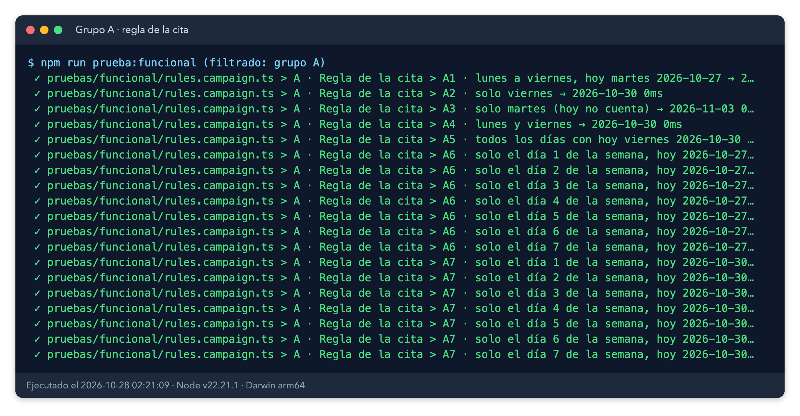

*Evidencia 1. Log real filtrado al grupo A (regla de la cita): 19 líneas, todas OK.*

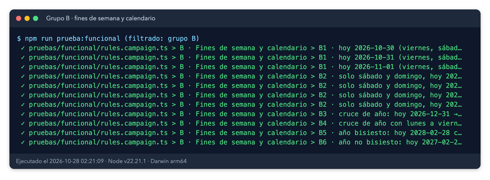

*Evidencia 2. Log real del grupo B (fines de semana y calendario): 11 líneas.*

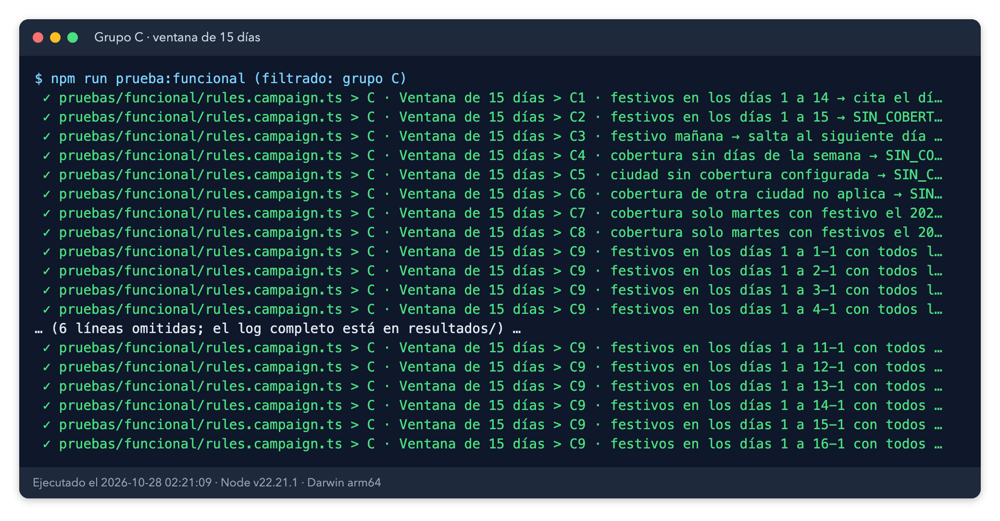

*Evidencia 3. Log real del grupo C (ventana de 15 días). Se omiten líneas intermedias, indicado en la imagen.*

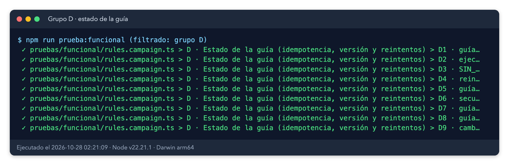

*Evidencia 4. Log real del grupo D (estado de la guía, idempotencia y versión).*

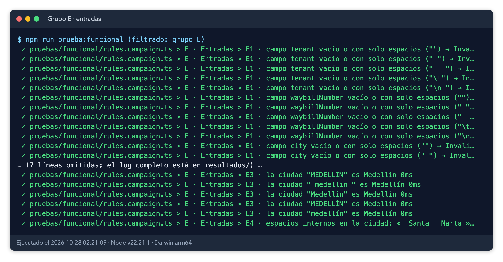

*Evidencia 5. Log real del grupo E (entradas). Se omiten líneas intermedias.*

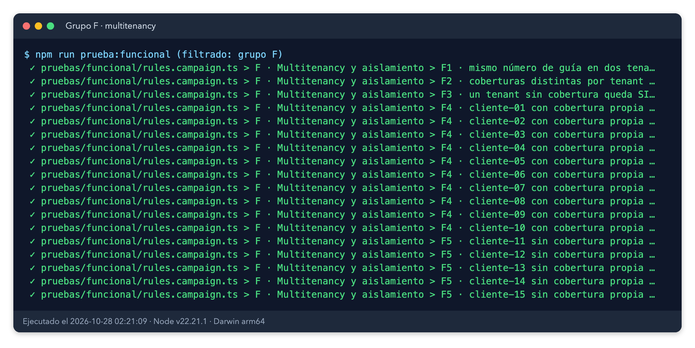

*Evidencia 6. Log real del grupo F (multitenancy y aislamiento).*

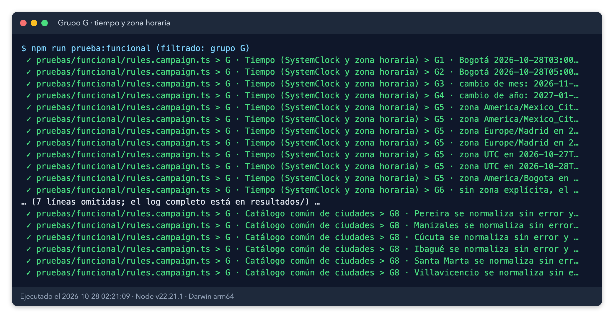

*Evidencia 7. Log real del grupo G (tiempo y zona horaria). Se omiten líneas intermedias.*

**Grupo H (diferencial).** 10.000 casos: 9.446 agendadas y 554 sin cobertura, 0 discrepancias.

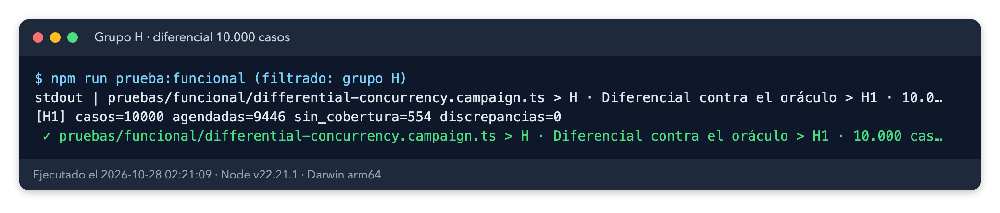

*Evidencia 8. Salida real de H1: casos=10000, agendadas=9446, sin_cobertura=554, discrepancias=0.*

**Grupo I (concurrencia).** Todos pasaron. Con 2 y con 50 solicitudes simultáneas sobre la misma guía, la cita es la misma y hay 1 escritura real. Las 50 guías distintas se escriben 50 veces, una por guía. La versión vieja lanza `VersionConflict`. El caso de uso reintenta exactamente 2 veces.

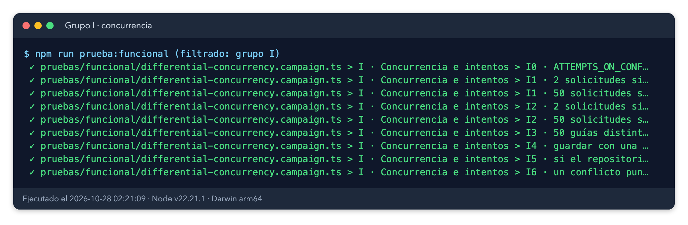

*Evidencia 9. Log real del grupo I (concurrencia e intentos).*

**Ejecución completa tras la traducción.** `npm run prueba:funcional` pasa 141 de 141 (`ejecucion-traduccion.log`).

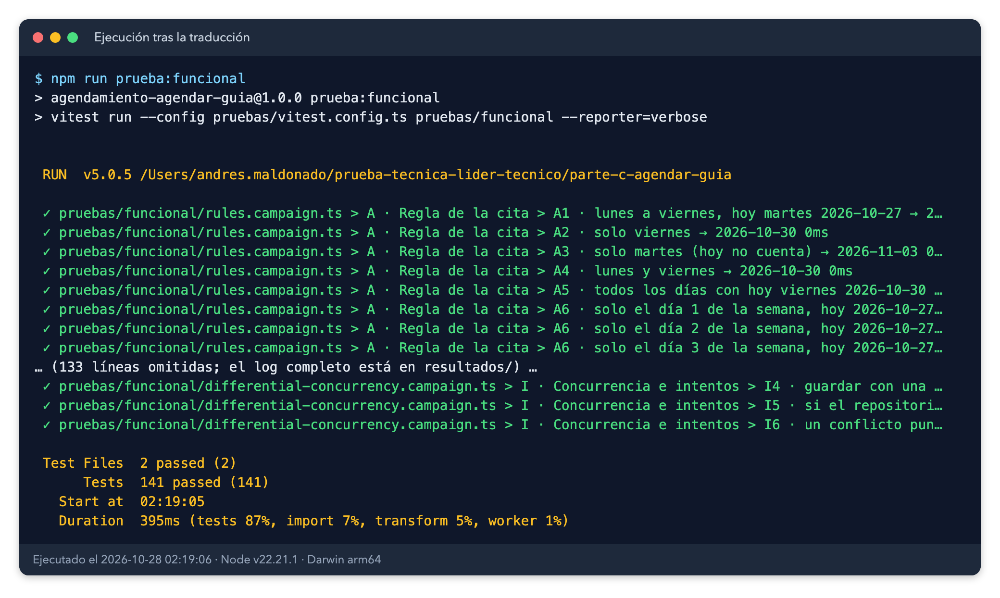

*Evidencia 10. Log real de `npm run prueba:funcional` tras la traducción: 141 pruebas pasan. Se omiten líneas intermedias.*

**Regresión (`npm test`).** 80 de 80 pasan (`regresion-traduccion.log`).

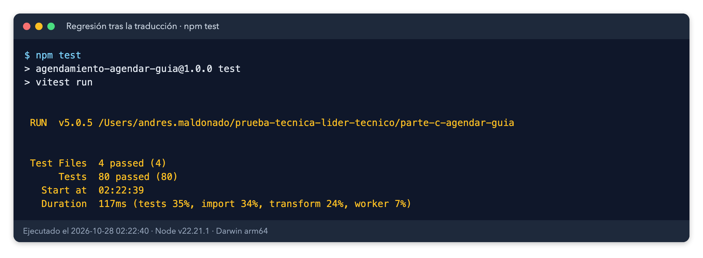

*Evidencia 11. Log real de `npm test` tras la traducción: 80 pruebas en 4 archivos, todas pasan.*

**Cobertura de la suite funcional sobre `src/`.** 77,84 % de sentencias (130/167), 68,67 % de ramas (57/83), 82,14 % de funciones (46/56) y 80,13 % de líneas (117/146) (`cobertura-funcional-traduccion.log`). Bajan respecto a la cobertura anterior (91,36 %). `src/` tiene ahora más código de configuración por variables de entorno que esta suite no ejerce. El log no atribuye la caída a un archivo concreto.

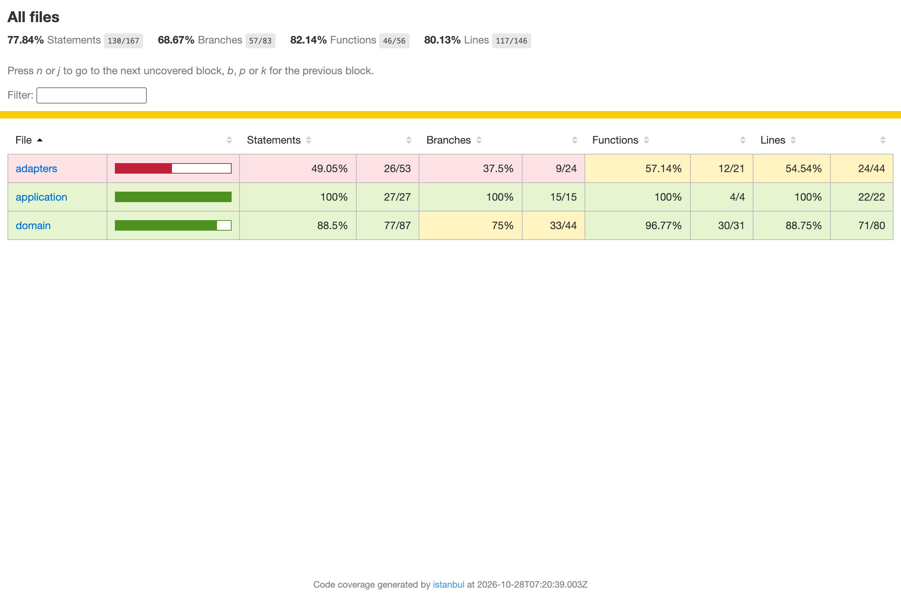

*Evidencia 12. Informe HTML de cobertura de la suite funcional, capturado con Chrome headless: sentencias 130/167 (77,84 %), ramas 57/83 (68,67 %).*

## 5. Validación de las pruebas por mutación

Para comprobar que la suite no es decorativa, se rompió a propósito el producto de 7 maneras distintas (`pruebas/funcional/mutaciones.json`, script `pruebas/_comun/mutaciones.py`). Cada mutación debe hacer fallar al menos una prueba. Antes de mutar, la línea base de la suite pasa sin fallos (0 de 141). Tras cada mutación se restauró `src/` y el log confirma que quedó idéntico. La mutación M2 apunta ahora a `src/domain/scheduling-policy.ts`, donde está la lista de días hábiles.

| ID | Rotura introducida en `src/` | Pruebas que fallan (de 141) | Resultado |
|---|---|---|---|
| M1 | ventana de 14 días en lugar de 15 (`WINDOW_DAYS`) | 3 | Detectada |
| M2 | el sábado cuenta como día hábil | 11 | Detectada |
| M3 | hoy cuenta (la búsqueda empieza en d=0) | 68 | Detectada |
| M4 | sin idempotencia: una guía agendada se recalcula | 9 | Detectada |
| M5 | el repositorio ignora los conflictos de versión | 5 | Detectada |
| M6 | la ciudad no se normaliza a mayúsculas | 4 | Detectada |
| M7 | el reloj ignora la zona horaria (usa UTC) | 8 | Detectada |

Resultado: 7 de 7 mutaciones detectadas (`mutaciones-traduccion.log`). Durante la ejecución, dos corridas simultáneas del script de mutaciones (una de la suite de seguridad y otra de esta) dejaron un residuo en `src/` (una condición `if (false)` en `src/domain/civil-date.ts`); se detectó, se restauró y se añadió un bloqueo exclusivo al script. Por esa causa, el primer intento de esta corrida dio M1 «no detectada» (0 pruebas fallan); ese log queda en `mutaciones-traduccion-artefacto.log` y no es válido. La corrida final se hizo con `src/` limpio y sin otra mutación en curso. Las pruebas no son decorativas: cada rotura plausible de la regla, la idempotencia, la concurrencia, la normalización y la zona horaria produce fallos. Esta validación no sustituye a la ejecución normal: solo demuestra que la suite sería capaz de detectar esas roturas.

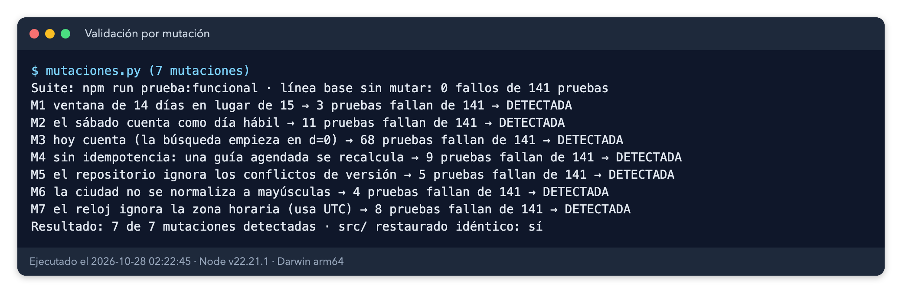

*Evidencia 13. Log real de la validación por mutación: 7 de 7 detectadas, `src/` restaurado idéntico.*

## 6. Hallazgos y correcciones

Sin hallazgos de esta prueba funcional. Ningún caso falló, el diferencial dio 0 discrepancias y la validación por mutación detecta las 7 roturas. Esto no prueba que el producto esté libre de defectos: se probó únicamente la API pública con adaptadores en memoria.

**Hallazgo de herramienta (ya corregido):** dos corridas simultáneas del script de mutaciones dejaron un residuo en `src/`. Se detectó, se restauró y el script ahora usa un bloqueo exclusivo.

## 7. Conclusiones, límites y riesgos residuales

El criterio de aprobación de la prueba funcional se cumple: 141 de 141 casos pasan tras la traducción, el diferencial H1 tiene 0 discrepancias y las 7 mutaciones se detectan. La regla de la cita, la ventana, la idempotencia, la versión, las entradas, el aislamiento por tenant, la zona horaria y la concurrencia se comportan como especifica el enunciado. La regresión `npm test` está en verde: 80 de 80.

**Qué NO prueba este informe:** red, base de datos, control optimista real con PostgreSQL, latencias reales, Cloud Run, Pub/Sub ni seguridad (esta última la cubre la prueba de seguridad). Tampoco prueba el reintento tras fallos transitorios del repositorio (`tasaFallo`), ni la configuración por variables de entorno (`SCHEDULING_WINDOW_DAYS`, `SCHEDULING_CONFLICT_ATTEMPTS`, `SCHEDULING_BUSINESS_DAYS`, `SCHEDULING_TIME_ZONE`), que cubren las pruebas unitarias de `test/settings.test.ts`. Los datos de cobertura y festivos son los que entrega el puerto; no se valida el calendario real de festivos de Colombia.

**Qué quedaría por probar en un entorno real:** repositorios PostgreSQL con concurrencia real, lote nocturno reanudable (Parte A §6 riesgo 4), fallos transitorios con `tasaFallo`, festivos de Colombia cargados desde el calendario de la empresa, y la configuración por entorno en un despliegue real.
