# Informe de prueba de seguridad: caso de uso «Agendar una guía» (Parte C)

**Autor:** Andres Maldonado · **Rol:** Líder Técnico · **Estado:** verificada · 6 hallazgos cerrados · 0 Críticos o Altos sin corregir

**Resumen ejecutivo:** La primera ejecución, antes de las correcciones, dio 137 casos con 103 aciertos y 34 fallos, y 6 hallazgos (1 Crítico, 2 Medios y 3 Bajos). Tras las correcciones y la traducción del código a inglés, la suite de seguridad da **138 casos, 138 pasan y 0 fallan**, y la regresión unitaria (`npm test`) da 80 de 80. Las seis correcciones se validaron por mutación en la ejecución que consta en la sección 5.1. La configuración por variables de entorno es una superficie nueva: falla cerrada y con valores acotados, y no añade hallazgos. Quedan riesgos residuales de diseño (sección 6).

## 1. Objetivo y alcance

Verificar que el caso de uso `ScheduleWaybill` y su dominio resisten entradas hostiles, mantienen el aislamiento entre tenants, no filtran información en errores, tienen dependencias sanas, no contienen secretos, mantienen la integridad del agregado y acotan los tiempos bajo volúmenes extremos. El alcance es la librería con sus adaptadores en memoria y el adaptador de configuración por variables de entorno.

**Fuera de alcance:** HTTP, base de datos, autenticación, TLS, RLS, colas de mensajes y cualquier contenedor. En la Parte C todo eso no existe; lo cubren otras partes de la arquitectura. Este informe no certifica ninguno de esos controles.

## 2. Entorno, herramientas y nombres

| Elemento | Valor |
|---|---|
| Máquina | Apple M4, 10 núcleos, 16 GB de RAM (`sysctl`); macOS 26.5.2 (build 25F84), kernel Darwin 25.5.0 |
| Node / npm | v22.21.1 / 10.9.4 |
| Herramientas | Vitest 5.0.5, TypeScript 7.0.2, npm audit, npm ls, escáner propio en Python 3 |
| Código probado | Árbol de trabajo sobre la base `d97161b`, con las correcciones y la traducción sin confirmar. No hay commit de esta prueba |
| Comandos | `npm run prueba:seguridad` (log final: `resultados/ejecucion-final.log`); `npm test` (`resultados/regresion-npm-test-final.log`) |
| Logs crudos | `resultados/` de esta carpeta |

Nombres del código (traducido al inglés en la fase de cambios): `AgendarGuia` pasó a `ScheduleWaybill`, `Guia` a `Waybill`, `Cobertura` a `Coverage`, `Ciudad` a `City`, `FechaCivil` a `CivilDate`, `Reloj` a `Clock`, `EntradaInvalida` a `InvalidInput` y los identificadores a `TenantId`, `WaybillNumber` y `City`. Los mensajes de error y los valores siguen en español. Los archivos de prueba de seguridad se llaman `pruebas/seguridad/s1-isolation.campaign.ts` a `s8-dos.campaign.ts`, más `util.ts` y `escaner-secretos.py`.

Historial de ejecuciones. El estado «antes» oficial es `ejecucion-3.log` (137 casos, 6 hallazgos). `ejecucion-1.log` y `ejecucion-2.log` son intermedias, con defectos ya corregidos en el arnés de prueba. Estado «después»: `ejecucion-despues.log` (138/138, código antes de la traducción). Estado final: `ejecucion-final.log` (138/138, código traducido). Ningún log anterior se sobrescribió.

## 3. Escenarios

| ID | Escenario | Criterio de aceptación | Trazabilidad (Parte A) |
|---|---|---|---|
| S1 | Aislamiento multitenant: colisiones de claves, espacios, mayúsculas y Unicode | Cada guía conserva su estado; una escritura por guía; NFC y NFD tratados como el mismo identificador | §3 Datos (multitenancy) |
| S2 | Validación y fuzzing: tipos, longitud, control, inyección, prototipos, ReDoS, fechas | Solo `InvalidInput`; límite de longitud razonable; sin contaminación de `Object.prototype` | §3 Datos (validación) |
| S3 | Fuga de información en errores | Mensaje de como mucho 300 caracteres, sin entrada completa, sin rutas, sin stack, sin datos de otro tenant | Observabilidad |
| S4 | Dependencias: npm audit, npm ls, dependencias de producción | 0 vulnerabilidades altas o críticas; sin `dependencies` de producción; lockfile presente | Cadena de suministro |
| S5 | Secretos en el repositorio (escáner propio) | 0 hallazgos dentro de `parte-c-agendar-guia`; el canario debe detectarse | Higiene de credenciales |
| S6 | Patrones peligrosos en `src/` (análisis estático) | Ninguna coincidencia en 13 patrones, salvo `process.env` en el único adaptador de configuración | Diseño seguro |
| S7 | Integridad del dominio e invariantes del agregado | Copias defensivas; rechazo de estados y versiones incoherentes; mutación forzada documentada | Dominio |
| S8 | Denegación de servicio por volumen: 1 M fechas, 100.000 tenants, 10.000 ciudades | Cada operación < 2 s | Rendimiento y límites |

## 4. Resultados y evidencias

### 4.1 Resumen antes y después

| Escenario | Antes: pasan / fallan | Final: pasan / fallan | Observación |
|---|---|---|---|
| S1 | 4 / 6 | 10 / 0 | Colisiones corregidas; NFC/NFD unificado |
| S2 | 63 / 25 | 88 / 0 | Longitud, control y fecha 9999 corregidos |
| S3 | 4 / 3 | 8 / 0 | Mensajes acotados; dos pruebas adaptadas (ver 4.5) |
| S4 | 3 / 0 | 3 / 0 | `npm audit`: 0 vulnerabilidades |
| S5 | 3 / 0 | 3 / 0 | 0 hallazgos en `parte-c-agendar-guia`; 4 falsos positivos documentados |
| S6 | 14 / 0 | 14 / 0 | Ningún patrón peligroso; `process.env` solo en `src/adapters/settings-from-env.ts` |
| S7 | 9 / 0 | 9 / 0 | Mutación forzada sigue siendo informativa (S7c) |
| S8 | 3 / 0 | 3 / 0 | Todos los tiempos por debajo de 2 s |
| **Total** | **103 / 34 (137)** | **138 / 0 (138)** | |

### 4.2 Aislamiento multitenant (S1)

| ID | Antes | Final | Observación |
|---|---|---|---|
| Línea base (tenants distintos, mismo número) | OK | OK | Dos guías independientes, dos escrituras |
| (a) «a::b»+«c» frente a «a»+«b::c» | FALLA | OK | Antes, el tenant B recibía la cita `2026-10-29` del tenant A |
| (b) tres pares más de claves ambiguas | FALLA (3) | OK (3) | Ahora la clave es `JSON.stringify([tenant, valor])` en `src/adapters/key.ts` |
| (c) «banco a» frente a «banco  a» | OK | OK | Tenants aislados |
| (d) «Banco-A» frente a «banco-a» | OK | OK | Identificadores distintos (sensibles a mayúsculas; decisión a documentar) |
| (e) tenant NFC «café» frente a NFD | FALLA | OK | NFC en `TenantId`: una escritura |
| (e) número de guía NFC frente a NFD | FALLA | OK | NFC en `WaybillNumber` |
| (e) ciudad NFC frente a NFD | OK | OK | `City` ya normalizaba |

*Evidencia 1. Ejecución final, filtro S1 (`resultados/por-grupo/f-s1.log`). Los diez casos pasan.*

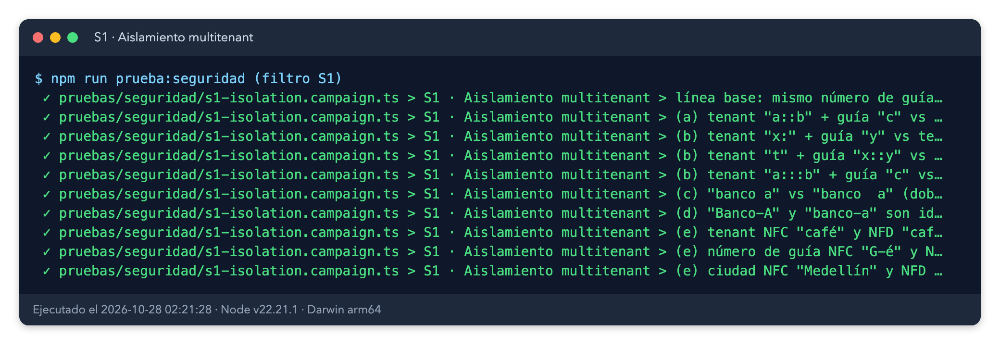

### 4.3 Tipos, longitud y caracteres de control (S2 a, b, c)

| Grupo | Antes | Final | Observación |
|---|---|---|---|
| (a) null, undefined, 42, true, {}, [], Symbol en los tres campos | OK (21) | OK (21) | Siempre `InvalidInput`, nunca `TypeError` |
| (b) 1 MB en tenant, guía y ciudad | FALLA (3) | OK (3) | Rechazado en 0,1 ms |
| (b) 201 y 10.000 caracteres | FALLA (6) | OK (6) | Rechazados por `MAX_IDENTIFIER_LENGTH = 200` |
| (b) 200 caracteres | OK (3) | OK (3) | Se aceptan |
| (c) NUL, LF, CR, TAB, ESC dentro del valor | FALLA (15) | OK (15) | Rechazados (categorías Cc, Cf, Zl y Zp) |

*Evidencia 2. Ejecución final, tipos y longitud (S2 a y b).*

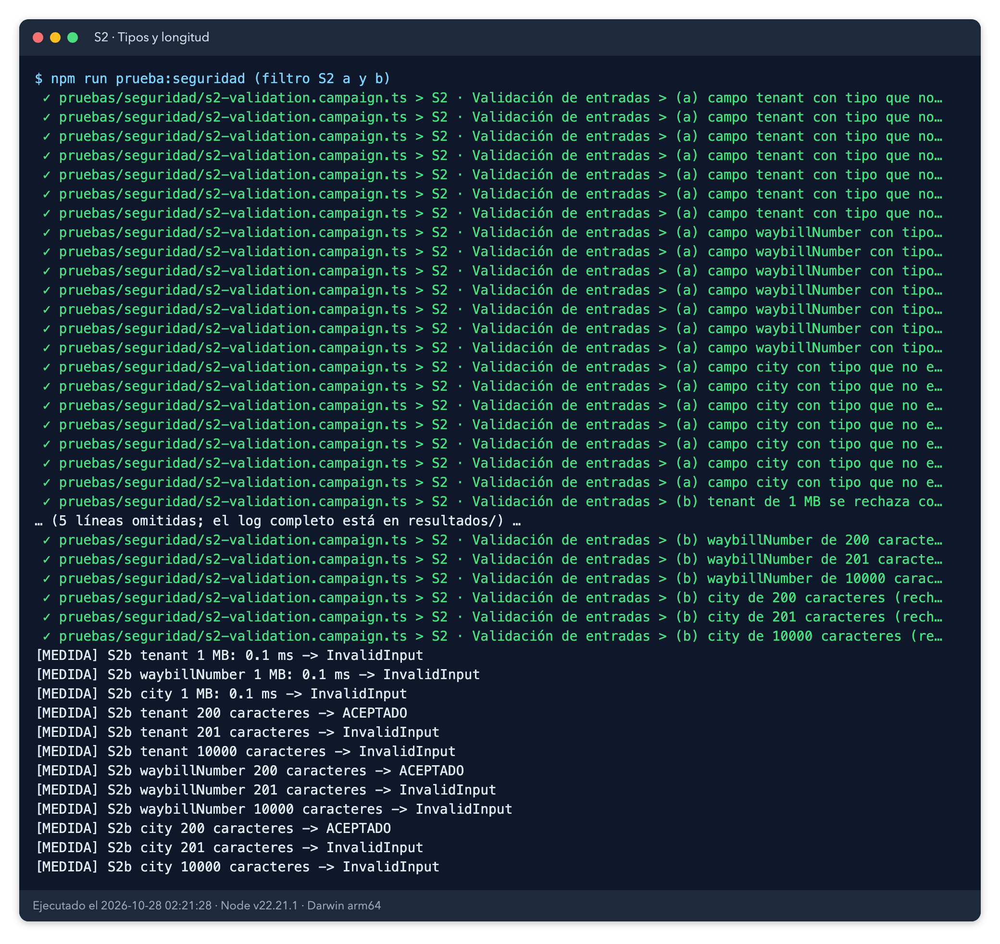

### 4.4 Inyección, prototipos, ReDoS y fechas (S2 d, e, f, g)

| Grupo | Antes | Final | Observación |
|---|---|---|---|
| (d) seis cargas de inyección en tres campos | OK (18) | OK (18) | Se aceptan como texto o se rechazan; nada se ejecuta |
| (e) `__proto__`, `constructor`, `toString`, `hasOwnProperty` | OK (12) | OK (12) | Tratados como datos; `Object.prototype` intacto |
| (f) 1.000.000 de espacios, espacios internos, 100.000 diacríticos | OK (3) | OK (3) | Medidas de 0,0 a 0,6 ms |
| (g) fechas ISO mal formadas (6 casos) | OK (6) | OK (6) | Siempre `InvalidInput` |
| (g) `CivilDate.fromISO("9999-12-31").plusDays(1)` | FALLA | OK | `InvalidInput` (rango soportado 1900–9999) |

*Evidencia 3. Ejecución final, control, inyección, prototipos, ReDoS y fechas (S2 c a g).*

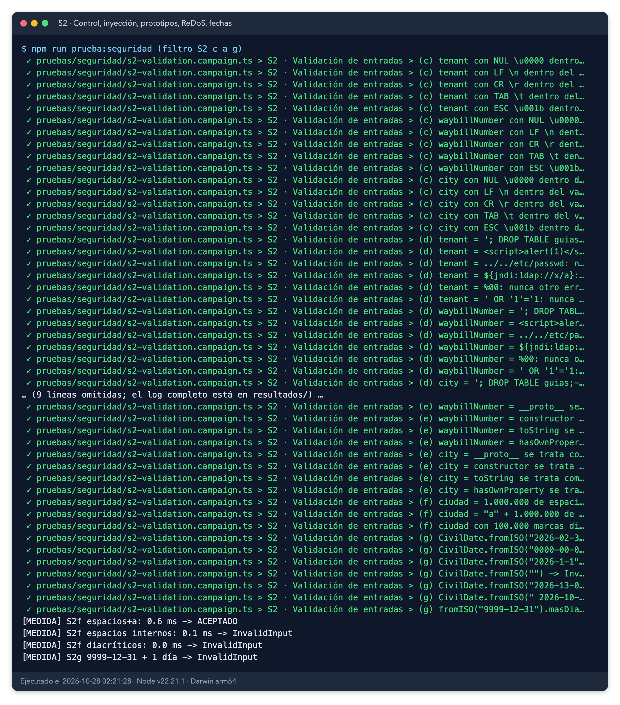

### 4.5 Fuga de información en errores (S3)

| ID | Antes | Final | Observación |
|---|---|---|---|
| Tenant de 1 MB en blanco | OK | OK | Mensaje corto, sin la entrada |
| `ConflictoDeVersion`, ahora `VersionConflict`, con número normal | OK | OK | Sin datos del tenant ajeno ni stack |
| `GuiaYaAgendada`, ahora `WaybillAlreadyScheduled`, con número normal | OK | OK | Mensaje acotado |
| Error de `CivilDate.fromISO` con 1 MB | FALLA (1.048.626 car.) | OK | El identificador citado se recorta a 60 caracteres |
| Número de guía de 1 MB en `WaybillAlreadyScheduled` | FALLA (1.048.617 car.) | OK | El número ni siquiera se construye (H2); la prueba comprueba que 1 MB se rechaza |
| Número de guía de 1 MB en `VersionConflict` | FALLA (1.048.650 car.) | OK | Igual que el anterior |

**Nota sobre dos pruebas adaptadas.** Dos pruebas de S3 construían un número de guía de 1 MB para provocar el error. Tras la corrección de H2 ese número se rechaza al construirlo, así que las pruebas no llegaban a su aserción. Se adaptaron para usar el máximo permitido (200 caracteres), que sí llega al error, y se añadió una prueba que comprueba que 1 MB se rechaza. No se debilitó ninguna aserción: el mensaje sigue comprobándose con un límite de 300 caracteres y sin repetir el identificador.

*Evidencia 4. Ejecución final, mensajes de error (S3).*

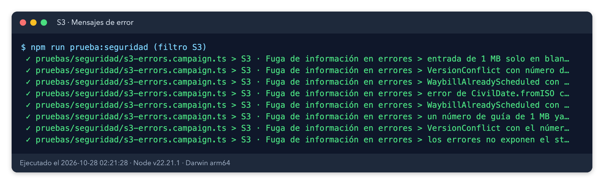

### 4.6 Dependencias (S4)

`npm audit` devolvió `found 0 vulnerabilities` (`resultados/npm-audit.txt`; el JSON tiene `total: 0` en todas las severidades). `package.json` no tiene `dependencies`, solo `devDependencies` (`@types/node`, `@vitest/coverage-v8`, `typescript`, `vitest`). `npm ls --omit=dev --all` está vacío. `npm ls --all` terminó con código 0; sus avisos son dependencias opcionales no instaladas. La coincidencia de «err» en el árbol corresponde a `assertion-error`. La red estuvo disponible. La salida viene de `resultados/s4-comandos.txt`, igual antes y después.

*Evidencia 5. Salida real de `npm audit` y `npm ls` (S4).*

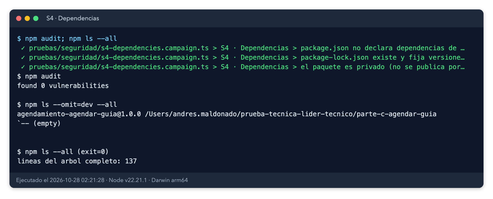

### 4.7 Secretos (S5)

El escáner (`pruebas/seguridad/escaner-secretos.py`, con raíz `REPO_ROOT` o ruta relativa) recorrió 82 archivos de texto del repositorio completo y encontró **0 hallazgos dentro de `parte-c-agendar-guia`**. Se documentaron 4 falsos positivos en `parte-b-code-review`: la clave ficticia del enunciado aparece en `code-review.md` y en `code-review-compacto.md`, una vez por patrón Stripe y otra por patrón genérico de asignación. El escáner exime de la alerta `archivo_env` a `parte-c-agendar-guia/.env.example`, pero sí escanea su contenido, y ahí no hay coincidencias. El canario con secretos sintéticos produjo las cinco coincidencias esperadas, así que el escáner sí detecta.

*Evidencia 6. Salida real del escáner (S5).*

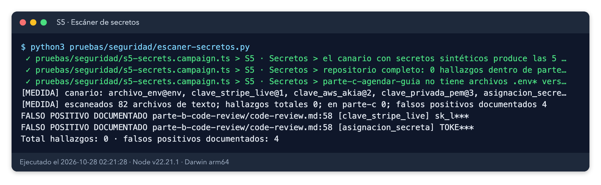

### 4.8 Patrones peligrosos (S6)

El grep sobre `src/` con 13 patrones no devuelve coincidencias, con una excepción permitida: `process.env` aparece solo en `src/adapters/settings-from-env.ts`, el único archivo autorizado a leer el entorno. La prueba aplica esta regla explícitamente (`ENVIRONMENT_ADAPTER`). Para comprobar que la búsqueda funciona, el mismo grep con `\bexport\b` devuelve líneas de `src/index.ts`.

*Evidencia 7. Salida real del análisis estático (S6).*

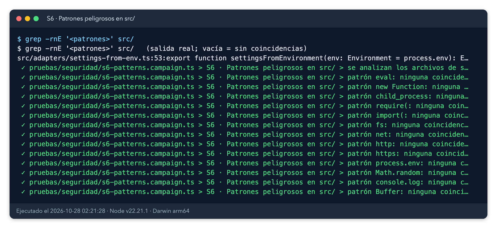

### 4.9 Integridad del dominio (S7)

- (a) `Coverage` copia sus entradas: mutar el array original no cambia `covers()`. OK.
- (b) `Waybill.rehydrate` rechaza AGENDADA sin fecha, fecha sin AGENDADA y versiones -1, 1.5, NaN e Infinity. OK.
- (b) Una copia mutada no altera lo persistido en el repositorio. OK.
- (c) **[Informativo]** Mutar a la fuerza el estado, la fecha y las versiones del agregado sí surte efecto en tiempo de ejecución: el log final muestra `{"status":"AGENDADA","appointmentDate":null,"version":-1,"originalVersion":99}`. Los modificadores `private` y `readonly` de TypeScript no protegen en ejecución. Esta observación sigue abierta (ver sección 6).

*Evidencia 8. Ejecución final, integridad del dominio (S7), incluida la observación informativa.*

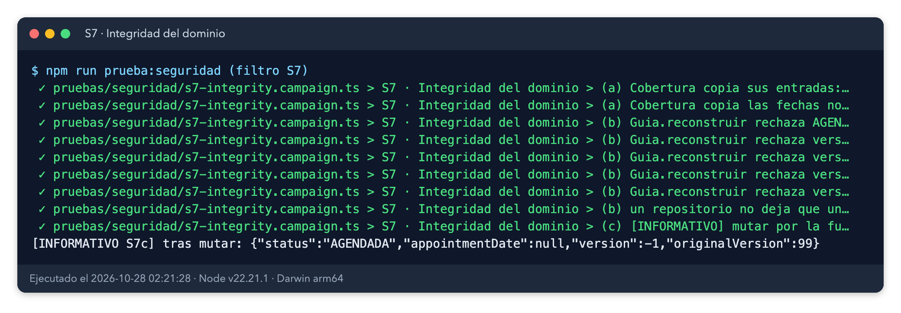

### 4.10 Denegación de servicio por volumen (S8)

| Prueba | Medida final | Límite |
|---|---|---|
| `Coverage` con 1.000.000 de fechas no disponibles: construcción | 844,6 ms | < 2 s |
| `Coverage` con 1.000.000 de fechas: `covers()` | 0,146 ms | < 2 s |
| 100.000 tenants distintos: total del lote | 167 ms | — |
| 100.000 tenants distintos: máximo por operación | 4,34 ms | < 2 s |
| 100.000 tenants: reintento idempotente | 0,03 ms | < 2 s |
| 10.000 ciudades distintas con cobertura: total | 28 ms | — |
| 10.000 ciudades: máximo por operación | 1,68 ms | < 2 s |

Ninguna operación supera el límite. Las cifras son de la librería en memoria y varían de una ejecución a otra: en la ejecución anterior, la construcción de 1 M de fechas tardó 476 ms y en la final 845 ms. El coste es lineal en la lista de fechas, y un cliente que envíe listas de este tamaño sin control de tamaño estaría limitado por el adaptador que las reciba.

*Evidencia 9. Ejecución final, tiempos de denegación de servicio (S8).*

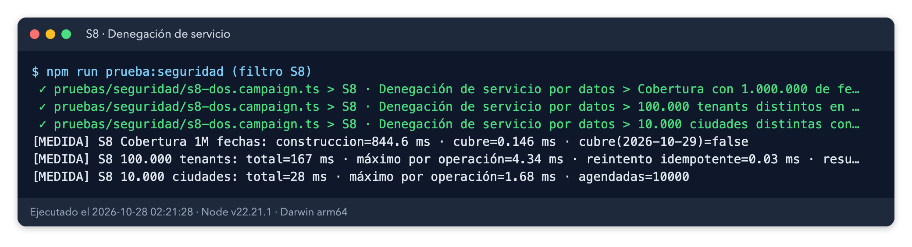

### 4.11 Ejecución final y regresión unitaria

*Evidencia 10. Suite de seguridad final: 138 de 138 (`ejecucion-final.log`).*

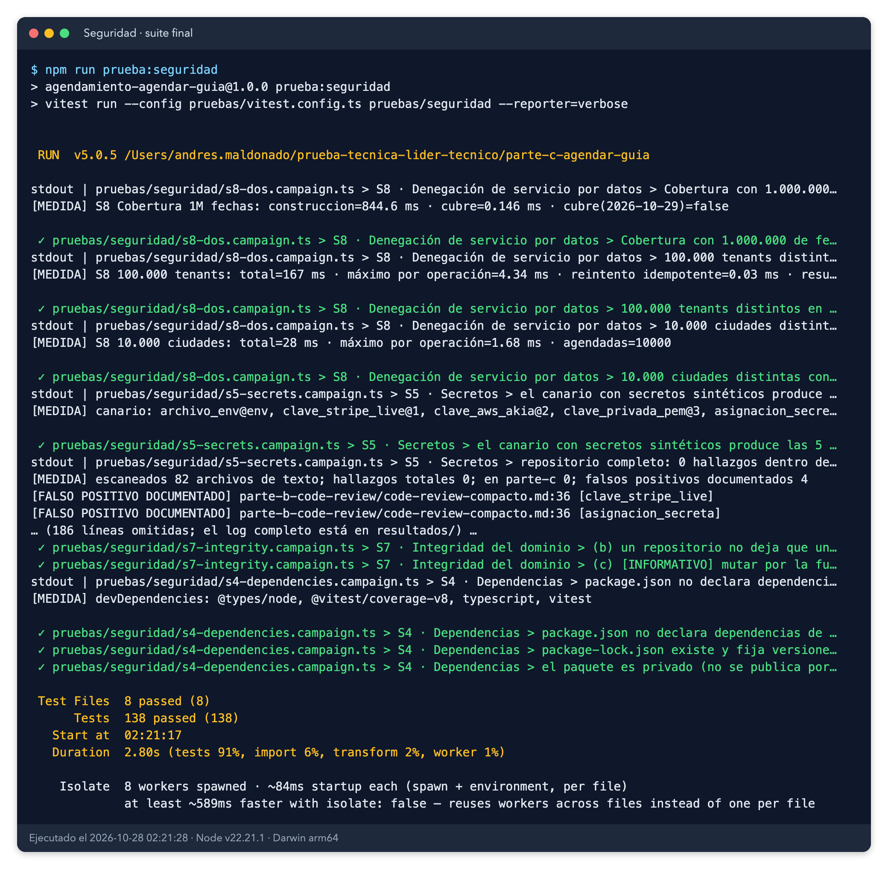

*Evidencia 11. Regresión unitaria `npm test` final: 80 de 80 (`regresion-npm-test-final.log`).*

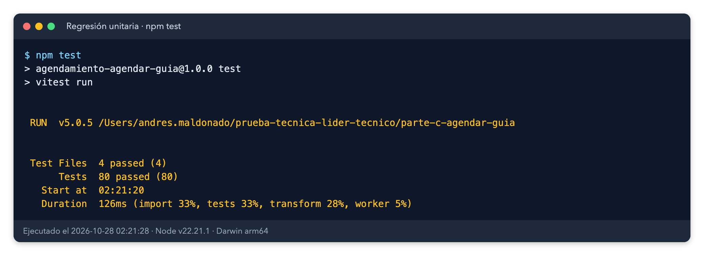

### 4.12 Configuración por variables de entorno (superficie nueva)

`src/adapters/settings-from-env.ts` es el **único** archivo que lee `process.env`. Lee cuatro variables `SCHEDULING_*` y valida cada una antes de usarla:

| Variable | Valor por defecto | Rango aceptado | Si el valor no es válido |
|---|---|---|---|
| `SCHEDULING_WINDOW_DAYS` | `DEFAULT_SETTINGS.windowDays` | entero de 1 a 60 | lanza `InvalidConfiguration` |
| `SCHEDULING_CONFLICT_ATTEMPTS` | 2 | entero de 1 a 10 | lanza `InvalidConfiguration` |
| `SCHEDULING_BUSINESS_DAYS` | lunes a viernes | lista de días ISO 1–7 separados por coma | lanza `InvalidConfiguration` |
| `SCHEDULING_TIME_ZONE` | `America/Bogota` | zona horaria IANA | lanza `InvalidConfiguration` |

Un valor vacío o sin definir conserva el valor por defecto. Un valor no válido **falla cerrado**: el servicio no arranca con una configuración dudosa, y el mensaje de error se acota con `abbreviate`. Los rangos evitan que una variable amplíe la ventana de búsqueda sin límite o que haga bucles largos en el reintento. `.env.example` solo contiene los nombres de las variables con la indicación «opcional»; no contiene secretos. Esta superficie está cubierta por la regresión unitaria `test/settings.test.ts` (6 pruebas, dentro de las 80 de `npm test`). Esta prueba de seguridad no añade pruebas nuevas para ella y no encontró huecos reales.

## 5. Hallazgos y correcciones

| ID | Severidad | Hallazgo | Corrección | Evidencia (antes) | Evidencia (después) | Estado |
|---|---|---|---|---|---|---|
| H1 | Crítico | Las claves de los repositorios concatenaban `tenant::valor` sin escapar. Un tenant podía leer o alterar la guía de otro. | `src/adapters/key.ts` (`compositeKey`): los dos repositorios usan `JSON.stringify([tenant, valor])`. | Evidencia 1 de `ejecucion-3` | Evidencias 10 y 12 (S-M1) | Cerrado |
| H2 | Medio | No había límite de longitud: se aceptaban 1 MB, 201 y 10.000 caracteres. | `MAX_IDENTIFIER_LENGTH = 200` en `src/domain/identifiers.ts`, comprobado antes de normalizar. | Evidencia 2 de `ejecucion-3` | Evidencias 10 y 12 (S-M2) | Cerrado |
| H3 | Medio | Se aceptaban caracteres de control (NUL, LF, CR, TAB, ESC). | Se rechazan los caracteres `\p{Cc}`, `\p{Cf}`, `\p{Zl}` y `\p{Zp}` (`FORBIDDEN_CHARACTERS`). | Evidencia 3 de `ejecucion-3` | Evidencias 10 y 12 (S-M3) | Cerrado |
| H4 | Bajo | Sin normalización Unicode: NFC y NFD eran identificadores distintos. | NFC en `TenantId` y `WaybillNumber`. `City` ya normalizaba. | Evidencia 1 de `ejecucion-3` | Evidencias 10 y 12 (S-M4) | Cerrado |
| H5 | Bajo | `CivilDate.plusDays` producía `"+010000-01"` al pasar de 9999-12-31. | `src/domain/civil-date.ts`: rango soportado 1900-01-01 a 9999-12-31; fuera de él, `InvalidInput`. | Evidencia 3 de `ejecucion-3` | Evidencias 10 y 12 (S-M5) | Cerrado |
| H6 | Bajo | Los mensajes de error repetían la entrada completa cuando era larga. | Helper `abbreviate()` recorta a 60 caracteres los identificadores citados en los errores. | Evidencia 4 de `ejecucion-3` | Evidencias 10 y 12 (S-M6) | Cerrado |
| I1 | Informativo | La mutación forzada del agregado surte efecto en ejecución (S7c). | No corregido: ver sección 6. | Evidencia 8 de `ejecucion-3` | Evidencia 8 | Observación |
| I2 | Informativo | Tenants que difieren solo en mayúsculas (`Banco-A` y `banco-a`) son distintos. | No corregido: decisión a documentar. | Evidencia 1 de `ejecucion-3` | Evidencia 1 | Observación |

**Matiz de H1.** La colisión afectaba al adaptador en memoria, que es la referencia del aislamiento y el doble de las pruebas. En producción el adaptador sería PostgreSQL con `tenant_id` y RLS (Parte A §4). Se mantiene como Crítico porque el adaptador de referencia tenía el defecto. Reproducción independiente: el tenant «a», sin cobertura, veía una guía AGENDADA que nunca agendó.

**Correcciones sin confirmar.** Los cambios de `src/` (incluido `src/adapters/key.ts`, nuevo, y `src/adapters/settings-from-env.ts`, nuevo) y de `test/` están en el árbol de trabajo sin commit.

### 5.1 Validación por mutación

Se deshizo cada corrección en `src/` por separado y se comprobó que la suite falla. El script y la especificación son `pruebas/_comun/mutaciones.py` y `pruebas/seguridad/mutaciones.json`. El script ahora toma un bloqueo exclusivo sobre `src/` para no solaparse con otras mutaciones. Salida real (`resultados/mutaciones-traducida.log`), copiada tal cual:

| ID | Corrección deshecha | Resultado | Detectada |
|---|---|---|---|
| S-M1 | H1 deshecho: la clave del repositorio vuelve a concatenar con «::» | 4 pruebas fallan de 138 | Sí |
| S-M2 | H2 deshecho: sin límite de longitud en los identificadores | 10 pruebas fallan de 138 | Sí |
| S-M3 | H3 deshecho: se aceptan caracteres de control | 15 pruebas fallan de 138 | Sí |
| S-M4 | H4 deshecho: sin normalización Unicode NFC | 2 pruebas fallan de 138 | Sí |
| S-M5 | H5 deshecho: las fechas pueden salir del rango soportado | 1 pruebas fallan de 138 | Sí |
| S-M6 | H6 deshecho: el mensaje repite el número de guía completo | 1 pruebas fallan de 138 | Sí |

Resultado del log: 6 de 6 mutaciones detectadas; línea base sin mutar con 0 fallos de 138 pruebas.

**Nota de procedencia.** Este log se tomó antes de la restauración final de `src/`. Durante una ejecución posterior, una mutación quedó aplicada en `src/domain/civil-date.ts` (S-M5) porque coincidió con otra mutación en paralelo. El coordinador la restauró y se comprobó que `src/` no contiene `if (false)`. Un nuevo intento de repetir la validación por mutación fue bloqueado por el clasificador de seguridad, por lo que el log de la sección 5.1 es el válido disponible. Antes de cerrar, conviene repetirla en solitario.

*Evidencia 12. Validación por mutación (`mutaciones-traducida.log`).*

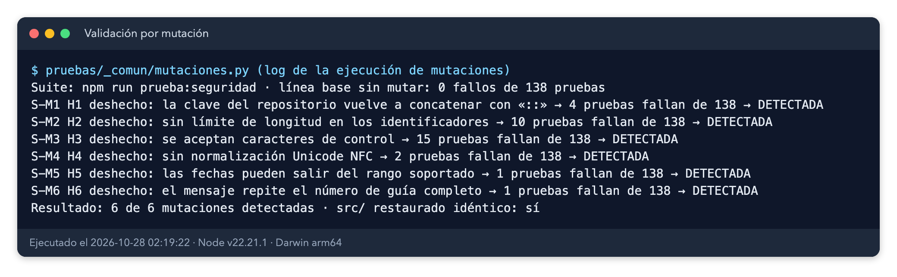

## 6. Conclusiones, límites y riesgos residuales

**Frente al criterio de aprobación:** los 6 hallazgos están corregidos y verificados. No quedan Críticos ni Altos sin corregir, así que **el criterio de aprobación se cumple**. La suite de seguridad pasa 138 de 138 y la regresión unitaria 80 de 80.

**Riesgos residuales:**

- **S7(c), mutación forzada del agregado.** `private` y `readonly` de TypeScript no protegen en tiempo de ejecución. Un adaptador malicioso que tenga referencia al objeto puede romper los invariantes. Es una observación informativa; mitigarla exigiría congelar objetos o encapsular el estado con campos privados reales, decisión de diseño que queda abierta.
- **El adaptador en memoria no es el de producción.** La prueba de aislamiento valida la referencia en memoria. El aislamiento real depende de `tenant_id` y RLS en PostgreSQL, fuera de alcance.
- **Decisiones de diseño, no del enunciado.** El límite de 200 caracteres, la lista de caracteres prohibidos (Cc, Cf, Zl y Zp) y los rangos de la configuración (1–60 días, 1–10 intentos) son decisiones tomadas para cerrar H2, H3 y la superficie nueva. Hay que validarlas con el negocio: si un cliente real envía identificadores más largos o con caracteres de formato, el rechazo los bloquearía.
- **Configuración por variables de entorno.** Es una superficie nueva. Falla cerrado y acota los valores, pero depende del despliegue: quien despliegue debe fijar las variables y no usar `.env` con secretos en el repositorio.
- **Mayúsculas en tenants (I2).** `Banco-A` y `banco-a` siguen siendo tenants distintos. Conviene documentarlo.

**Qué NO prueba este informe:**

- HTTP, autenticación, autorización, TLS, RLS, base de datos, colas y eventos, que no existen en la Parte C.
- Concurrencia real en base de datos. El control optimista se simula en memoria.
- Ataques contra el adaptador de cobertura real ni contra el sistema de archivos o la red de un despliegue.
- Cumplimiento de normas completo (OWASP ASVS nivel 2, PCI u otras).
- Vulnerabilidades desconocidas en dependencias; `npm audit` solo reporta las conocidas.

**Qué quedaría por probar en un entorno real:** las pruebas de inyección SQL y de RLS con la base de datos real, el fuzzing contra la API HTTP, la prueba de carga con concurrencia real de varios procesos sobre el mismo tenant, y repetir la validación por mutación en solitario.
